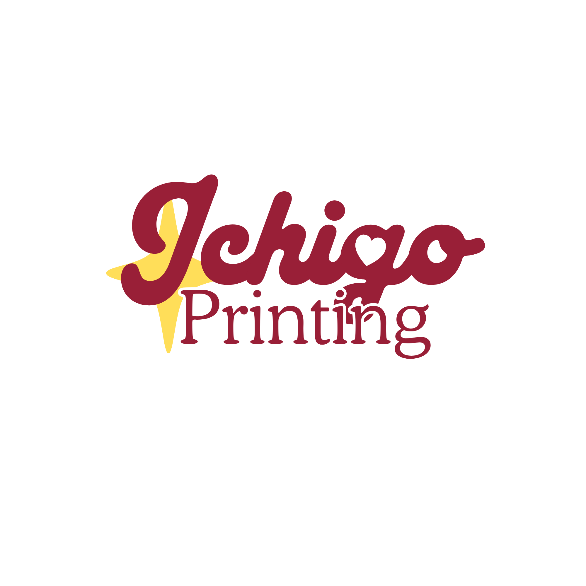
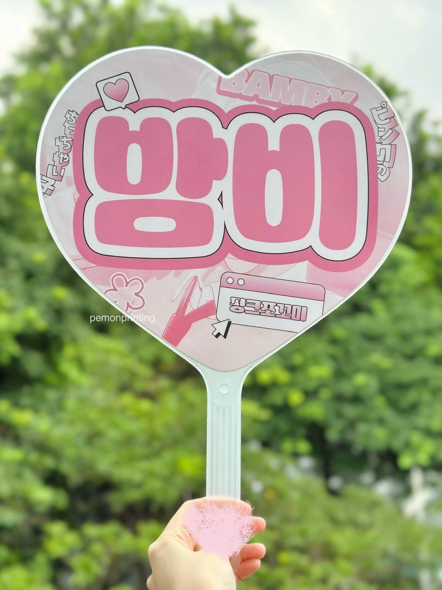
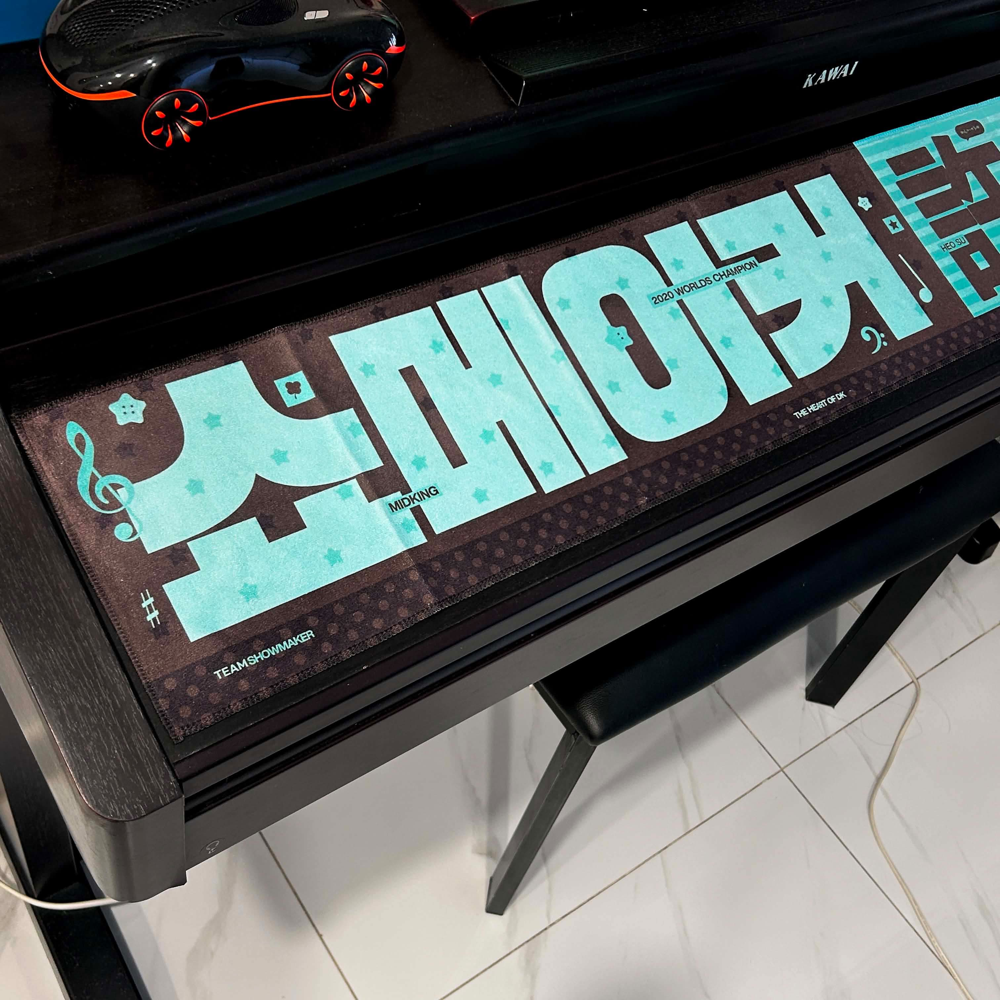
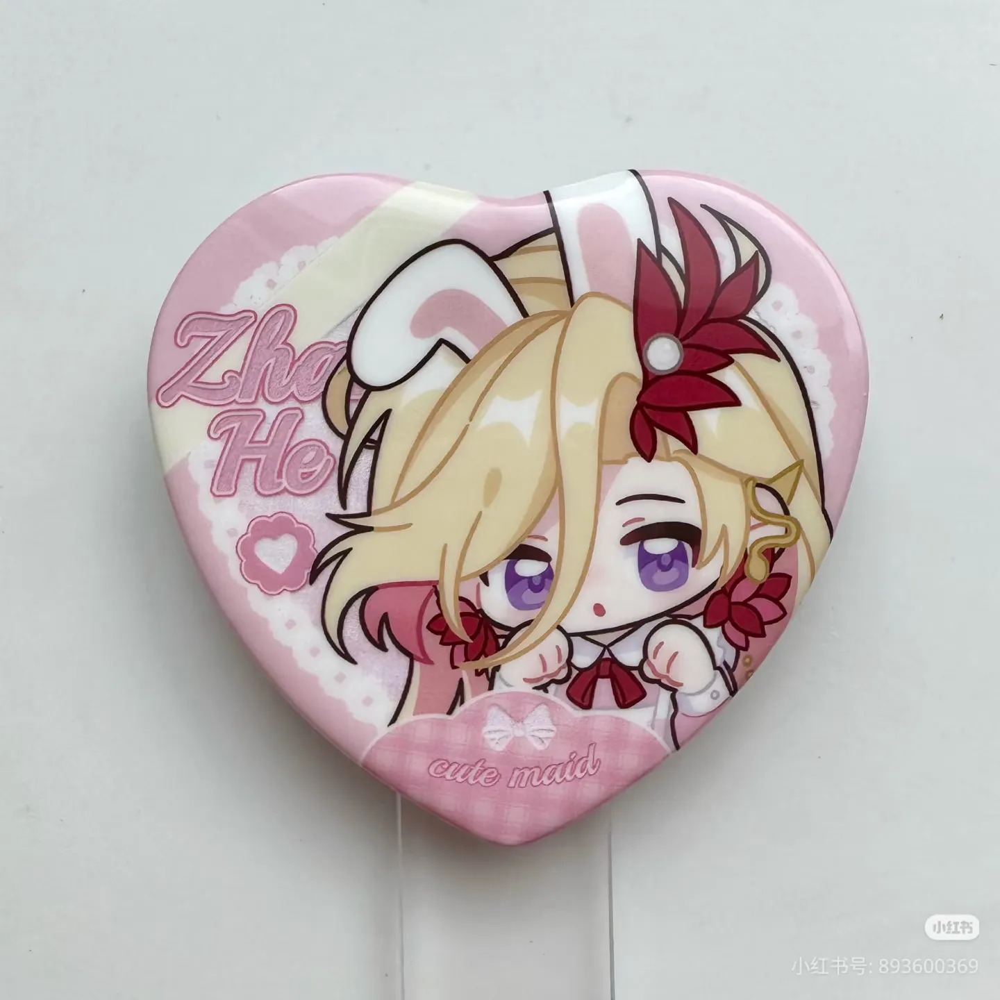

# AI Usage Log

**Dự án:** Ichigo Printing – K-pop Goods Printing Website

**Môn học:** Phát triển ứng dụng TMĐT  
**Giảng viên:** TS. Nguyễn Mạnh Tuấn – tuannm@ueh.edu.vn

---

## Lần sử dụng 1

### Công cụ
ChatGPT (OpenAI).

### Mục đích
Phân tích yêu cầu nghiệp vụ cho website Ichigo Printing, xác định mục tiêu, phạm vi, nhóm người dùng, chức năng, quy trình nghiệp vụ, yêu cầu phi chức năng và các rủi ro khi triển khai trong thời gian 8 tuần.

### Prompt
Bạn là chuyên gia phân tích nghiệp vụ cho dự án thương mại điện tử.

Thông tin dự án:
- Tên dự án: Ichigo Printing.
- Sản phẩm/dịch vụ: Đặt in slogan, towel vải, uchiwa và K-pop goods theo thiết kế riêng.
- Mô hình: Pre-order, gom đơn và gửi sản xuất tại xưởng Hàn Quốc.
- Khách hàng: Người hâm mộ K-pop từ 16–30 tuổi, fansite, fanclub và các nhóm kinh doanh goods.
- Vấn đề: Quy trình đặt hàng thủ công qua fanpage, khó gửi file, báo giá, xem trước thành phẩm và theo dõi đơn.
- Website tham khảo: MyCreativeShop, MARPPLE, Startee.
- Thời gian: 8 tuần.
- Nhóm: 7 thành viên.

Hãy đề xuất:
1. Mục tiêu và phạm vi dự án.
2. Các nhóm người dùng và quyền hạn.
3. Danh sách chức năng cần có.
4. Quy trình nghiệp vụ chính.
5. Yêu cầu phi chức năng.
6. Các chức năng nên hoàn thành ở phiên bản đầu tiên.
7. Các chức năng nâng cao có thể bổ sung.
8. Rủi ro triển khai và cách giảm thiểu.

Phân biệt yêu cầu bắt buộc, yêu cầu phát triển sau và nội dung cần nhóm xác minh. Không giả định nhóm có đủ thời gian để triển khai tất cả chức năng.

### Kết quả đề xuất
ChatGPT đề xuất phát triển website theo mô hình Make-to-Order kết hợp Pre-order, tập trung vào ba nhóm chức năng:

1. **Đặt in cá nhân hóa:** Chọn sản phẩm, quy cách, số lượng, upload file và xem mockup 2D.
2. **Quản lý đơn pre-order:** Tiếp nhận yêu cầu, kiểm duyệt file, báo giá, xác nhận thanh toán và gom đơn theo đợt.
3. **Theo dõi tiến độ:** Cập nhật trạng thái xử lý, sản xuất và vận chuyển.

Các đề xuất khác:
- Phân chia người dùng thành Guest, Customer, Admin và Staff.
- Tập trung vào hai dòng sản phẩm chính: slogan/towel và uchiwa.
- Đề xuất xác nhận thanh toán thủ công để giảm độ phức tạp.
- Đưa giỏ hàng nhiều sản phẩm, thanh toán tích hợp, voucher, vận chuyển và thống kê quản trị sang giai đoạn phát triển sau.
- Đưa ra kế hoạch triển khai 8 tuần và các rủi ro về file thiết kế, báo giá, bảo mật và tiến độ sản xuất.

### Phản biện
Nhóm sử dụng Gemini làm công cụ phản biện độc lập.

Gemini nhận xét kết quả ChatGPT phù hợp với nghiệp vụ đặt in và gom đơn pre-order, nhưng việc thu hẹp phạm vi đã bỏ sót một số yêu cầu bắt buộc của đồ án:

- Giỏ hàng và checkout phải được triển khai.
- Cần tích hợp ít nhất một phương thức thanh toán hoặc sandbox.
- Phải có chức năng tính phí vận chuyển và áp dụng voucher.
- Dashboard thống kê quản trị thuộc phạm vi bắt buộc.
- Cần bổ sung kiểm thử bảo mật XSS, SQL Injection, CSRF và IDOR.
- Cần làm rõ luồng xử lý từ checkout, kiểm duyệt file, báo giá đến thanh toán.

### Quyết định của nhóm
Nhóm giữ lại các chức năng đặc thù do ChatGPT đề xuất, gồm upload thiết kế, mockup 2D, kiểm duyệt file, báo giá và quản lý pre-order.

Đồng thời điều chỉnh phạm vi:
- Bổ sung giỏ hàng và checkout.
- Tích hợp thanh toán hoặc sandbox sau khi xác nhận báo giá.
- Tính phí vận chuyển theo khu vực.
- Bổ sung voucher, promotion và thống kê quản trị.
- Giữ vai trò Nhân viên xử lý đơn theo bảng phân quyền của nhóm.
- Bổ sung các yêu cầu bảo mật và kiểm thử.

Những chức năng phức tạp như chỉnh sửa thiết kế chuyên nghiệp, preview 3D và đồng bộ API trực tiếp với xưởng Hàn Quốc chưa được ưu tiên triển khai.

### Người kiểm tra
Phạm Duy Anh
Nguyễn Văn Trường

---

## Lần sử dụng 2

### Công cụ
Gemini (Google).

### Mục đích
Phản biện độc lập kết quả phân tích yêu cầu của ChatGPT, đối chiếu với quy định đồ án của giảng viên và xác định các chức năng cần bổ sung hoặc điều chỉnh trước khi thống nhất phạm vi dự án.

### Prompt
Bạn là người phản biện độc lập cho một dự án website thương mại điện tử do nhóm sinh viên thực hiện trong một học phần.

Dữ liệu đầu vào:
1. Bối cảnh dự án Ichigo Printing.
2. Kết quả phân tích yêu cầu do ChatGPT đề xuất.
3. File quy định đồ án của giảng viên.

Hãy đánh giá:
1. Các yêu cầu có giải quyết đúng vấn đề kinh doanh không?
2. Có chức năng trùng lặp hoặc không cần thiết không?
3. Có chức năng vượt quá phạm vi đồ án không?
4. Có thiếu chức năng hoặc quy trình nghiệp vụ cơ bản không?
5. Có rủi ro về dữ liệu, bảo mật và quyền riêng tư không?
6. Có yêu cầu chưa đủ rõ để lập trình và kiểm thử không?
7. Có điểm nào mâu thuẫn với quy định đồ án không?

Đặc biệt kiểm tra:
- Giỏ hàng và checkout.
- Thanh toán tích hợp hoặc sandbox.
- Shipping, voucher/promotion và thống kê quản trị.
- Phân quyền Customer, Staff và Admin.
- Quy trình duyệt file, báo giá, thanh toán và gom đơn.
- Xử lý các trường hợp ngoại lệ.

Với mỗi vấn đề, nêu lý do và đề xuất điều chỉnh. Không mặc định ChatGPT đúng và không tự ý thay đổi đề tài. Quyết định cuối cùng thuộc về nhóm.

### Kết quả đề xuất
Gemini xác định một số điểm chưa phù hợp trong đề xuất ban đầu:

| Nội dung | Đề xuất điều chỉnh |
|---|---|
| Giỏ hàng | Bổ sung giỏ hàng nhiều sản phẩm và checkout |
| Thanh toán | Tích hợp cổng thanh toán hoặc sandbox |
| Shipping | Tính phí giao hàng và lưu vào đơn |
| Voucher | Kiểm tra điều kiện, thời hạn và mức giảm |
| Thống kê | Dashboard doanh thu, đơn hàng, sản phẩm bán chạy |
| Phân quyền | Có thể gộp nghiệp vụ Staff vào Admin để đơn giản hóa |
| Bảo mật | Bổ sung kiểm thử XSS, SQLi, CSRF, IDOR |

Gemini cũng đề xuất luồng nghiệp vụ:

1. Khách hàng chọn sản phẩm, cấu hình và upload thiết kế.
2. Thêm sản phẩm vào giỏ hàng và checkout.
3. Hệ thống tạo yêu cầu chờ báo giá.
4. Admin kiểm duyệt file và xác nhận giá.
5. Khách hàng xác nhận mẫu, báo giá và thanh toán.
6. Đơn đủ điều kiện được gom vào đợt pre-order.
7. Admin cập nhật tiến độ sản xuất và giao hàng.

### Phản biện
Nhóm xem xét các đề xuất của Gemini dựa trên tính khả thi trong thời gian 8 tuần và đặc điểm kinh doanh của Ichigo Printing.

- Đồng ý cần bổ sung các chức năng cơ bản theo yêu cầu môn học.
- Thanh toán phải được thực hiện sau khi khách xác nhận báo giá cuối cùng.
- Chọn bảng phí giao hàng theo khu vực thay vì tích hợp API vận chuyển ngay.
- Không hoàn toàn áp dụng đề xuất gộp Staff vào Admin vì nhóm đã xây dựng bảng vai trò riêng.
- Chức năng thông báo email có thể phát triển thêm nhưng chưa được xác định là bắt buộc.
- Các quy cách file sản xuất cần được xác minh, không sử dụng giả định chưa có cơ sở.

### Quyết định của nhóm
Sau khi đối chiếu kết quả của hai công cụ AI, nhóm thống nhất:

1. **Giỏ hàng và checkout:** Bổ sung vào phạm vi bản nộp cuối.
2. **Thanh toán:** Tích hợp phương thức thanh toán hoặc sandbox sau khi xác nhận báo giá.
3. **Vận chuyển:** Sử dụng bảng phí theo khu vực, lưu phí và trạng thái giao hàng.
4. **Voucher/Promotion:** Triển khai kiểm tra và áp dụng mã giảm giá.
5. **Thống kê:** Bổ sung doanh thu, số đơn, sản phẩm bán chạy, đơn chờ giao và số khách hàng.
6. **Phân quyền:** Giữ vai trò Nhân viên xử lý đơn với các quyền nghiệp vụ phù hợp.
7. **Bảo mật:** Bổ sung các yêu cầu kiểm thử XSS, SQLi, CSRF và IDOR.
8. **Quy trình checkout:** Tách bước gửi yêu cầu đặt in và xác nhận thanh toán.
9. **Thông báo email:** Xếp vào chức năng bổ sung, chỉ triển khai khi đủ thời gian và nguồn lực.

Các quyết định này được sử dụng làm cơ sở hoàn thiện tài liệu yêu cầu hệ thống `REQUIREMENTS.md`.

### Người kiểm tra
Phạm Duy Anh
Nguyễn Văn Trường


---

## Buổi 2 - Trang giới thiệu và hiệu ứng tương tác

Nhật ký phần việc trình bày hai lượt chính được chọn: Prompt 6B và Prompt 8. Các lần thử trước khi nhóm có logo và ảnh sản phẩm không thuộc hai mục này.

### Lượt 1 - Prompt 6B - Xây dựng trang giới thiệu

**Công cụ:** Claude.  
**Ngày ghi nhận:** 03/11/2026.

#### Mục đích và đầu vào
Hoàn thiện trang About từ thiết kế đã duyệt, đưa logo và ảnh trong repo vào các khung có sẵn. Nội dung kế thừa tài liệu nhóm, giữ Roboto và #991F37.

#### Prompt 6B

Bản prompt được điền lại từ mẫu của giảng viên và dữ liệu đã sử dụng, không khẳng định là bản sao nguyên văn tin nhắn đã gửi.

<details>
<summary>Xem đầy đủ prompt 6B và HTML/CSS đầu vào</summary>

Nhóm tôi đang xây dựng trang about.html cho cửa hàng thương mại điện tử.

Thông tin cửa hàng:
- Tên: Ichigo Printing.
- Lĩnh vực: Đặt in K-pop goods theo thiết kế cá nhân hóa, tập trung vào slogan/towel vải và quạt uchiwa.
- Đối tượng khách hàng: Người hâm mộ K-pop, fansite, fanclub, nhóm tổ chức dự án và cá nhân hoặc nhóm kinh doanh goods.
- Điểm nổi bật: Tiếp nhận yêu cầu theo mô hình pre-order. Kiểm duyệt thiết kế, xác nhận báo giá và thanh toán trước khi gom đơn sản xuất tại Hàn Quốc.
- HTML/CSS hiện tại: Mã lưu bên dưới. Font Roboto, màu chủ đạo #991F37. Giữ bố cục và khoảng cách đã duyệt. Dùng logo.png và ba ảnh product-3.jpg, product-1.jpg, product-4.jpg trong các khung có sẵn. Liên hệ do thành viên cung cấp, Facebook là nội dung minh họa.

~~~html
<!DOCTYPE html>
<html lang="vi">
<head>
  <meta charset="UTF-8">
  <meta name="viewport" content="width=device-width, initial-scale=1">
  <title>Giới thiệu | Ichigo Printing</title>
  <meta name="description" content="Ichigo Printing, dịch vụ đặt in K-pop goods theo thiết kế cá nhân hóa: slogan/towel vải và quạt uchiwa, vận hành theo mô hình pre-order.">

  <link rel="preconnect" href="https://fonts.googleapis.com">
  <link rel="preconnect" href="https://fonts.gstatic.com" crossorigin>
  <link href="https://fonts.googleapis.com/css2?family=Roboto:wght@400;500;700;900&display=swap" rel="stylesheet">
  <link rel="stylesheet" href="../css/style.css">
  <link rel="stylesheet" href="../css/about.css">
</head>

<body class="page-about">

  <header class="header">
    <div class="container header__inner">
      <a class="logo" href="index.html">Ichigo Printing</a>
      <nav class="nav" aria-label="Điều hướng chính">
        <a href="index.html">Trang chủ</a>
        <a href="product.html">Sản phẩm</a>
        <a href="about.html" class="active" aria-current="page">Giới thiệu</a>
      </nav>
    </div>
  </header>

  <main>
    <section class="section" id="gioi-thieu" aria-labelledby="about-title">
      <div class="container about-intro">
        <div class="about-intro__text">
          <p class="about-eyebrow">Về Ichigo Printing</p>
          <h1 id="about-title">In dấu những <span>khoảnh khắc đặc biệt.</span></h1>
          <p class="about-lead">
            Đặt in slogan/towel vải và quạt uchiwa theo thiết kế của bạn.
          </p>
          <p>
            Ichigo Printing nhận yêu cầu theo mô hình pre-order,
            gom đơn theo từng đợt để chuyển sản xuất tại Hàn Quốc.
          </p>
          <p>
            Dịch vụ dành cho người hâm mộ K-pop, fansite, fanclub,
            các nhóm tổ chức dự án và cá nhân hoặc nhóm kinh doanh goods.
          </p>
          <a class="btn" href="#quy-trinh">Tìm hiểu cách đặt in</a>
        </div>

        <!-- Bổ sung ảnh chính thức của nhóm vào khu vực này. -->
        <div class="about-media" aria-hidden="true">
          <div class="about-media__slot about-media__slot--main"></div>
          <div class="about-media__slot"></div>
          <div class="about-media__slot"></div>
        </div>
      </div>
    </section>

    <section class="section section--alt" id="quy-trinh" aria-labelledby="process-title">
      <div class="container">
        <div class="about-section-head">
          <h2 id="process-title">Quy trình đặt in</h2>
          <p>Từ lựa chọn sản phẩm đến sản xuất và giao hàng.</p>
        </div>

        <ol class="steps about-steps">
          <li class="step">
            <h3>Chọn sản phẩm</h3>
            <p>Chọn sản phẩm, quy cách và số lượng cần in.</p>
          </li>
          <li class="step">
            <h3>Gửi thiết kế</h3>
            <p>Gửi file để nhân viên kiểm duyệt và trao đổi khi cần chỉnh sửa.</p>
          </li>
          <li class="step">
            <h3>Xác nhận báo giá</h3>
            <p>Kiểm tra thiết kế, báo giá và tổng tiền trước khi xác nhận, thanh toán.</p>
          </li>
          <li class="step">
            <h3>Sản xuất và giao hàng</h3>
            <p>Đơn đủ điều kiện được gom theo đợt để sản xuất tại Hàn Quốc và giao hàng.</p>
          </li>
        </ol>
      </div>
    </section>

    <section class="section about-contact-section" id="lien-he" aria-labelledby="contact-title">
      <div class="container about-contact-layout">
        <h2 id="contact-title">Liên hệ</h2>

        <!-- Thông tin liên hệ do Trường bổ sung sau. -->
        <address>
          <dl class="about-contact">
            <div>
              <dt>Email</dt>
              <dd></dd>
            </div>
            <div>
              <dt>Điện thoại</dt>
              <dd></dd>
            </div>
            <div>
              <dt>Mạng xã hội</dt>
              <dd></dd>
            </div>
          </dl>
        </address>

        <a class="btn" href="product.html">Xem sản phẩm</a>
      </div>
    </section>
  </main>

  <footer class="footer">
    <div class="container footer__bottom">Ichigo Printing</div>
  </footer>

</body>
</html>

~~~

~~~css
.page-about .header__inner {
  flex-wrap: wrap;
}

.page-about .section {
  padding-block: clamp(40px, 5vw, 72px);
}

.page-about #quy-trinh {
  scroll-margin-top: 144px;
}

.page-about .about-intro {
  display: grid;
  grid-template-columns: minmax(0, 1fr) minmax(0, 1fr);
  align-items: center;
  gap: clamp(32px, 5vw, 64px);
}

.page-about .about-intro > * {
  min-width: 0;
}

.page-about .about-eyebrow {
  margin-bottom: 16px;
  color: var(--primary);
  font-size: var(--fs-sm);
  font-weight: 500;
}

.page-about .about-intro h1 {
  margin-bottom: 24px;
  font-size: var(--fs-3xl);
  line-height: 1.08;
  letter-spacing: -0.025em;
}

.page-about .about-intro h1 span {
  display: block;
}

.page-about .about-lead {
  margin-bottom: 16px;
  font-size: var(--fs-lg);
  font-weight: 500;
  color: var(--ink);
}

.page-about .about-intro__text > p:not(.about-eyebrow):not(.about-lead) {
  max-width: 52ch;
  color: var(--ink-soft);
}

.page-about .about-intro__text > .btn {
  margin-top: 8px;
}

.page-about .about-media {
  display: grid;
  grid-template-columns: 1.4fr 0.8fr;
  grid-template-rows: repeat(2, minmax(0, 1fr));
  gap: 12px;
  width: 100%;
  aspect-ratio: 1.12 / 1;
}

.page-about .about-media__slot {
  background: var(--bg-alt);
  border: 1px solid var(--line);
  border-radius: var(--radius-sm);
}

.page-about .about-media__slot--main {
  grid-row: span 2;
}

.page-about .about-section-head {
  display: flex;
  flex-wrap: wrap;
  align-items: baseline;
  justify-content: space-between;
  gap: 8px 24px;
  margin-bottom: 32px;
}

.page-about .about-section-head h2,
.page-about .about-section-head p {
  margin-bottom: 0;
}

.page-about .about-section-head p {
  color: var(--ink-soft);
}

.page-about .about-steps .step {
  min-width: 0;
  padding-top: 20px;
  border-top: 1px solid var(--line);
}

.page-about .about-steps .step::before {
  position: static;
  display: block;
  width: auto;
  height: auto;
  margin-bottom: 20px;
  border-radius: 0;
  background: transparent;
  color: var(--primary);
  font-size: 2rem;
  font-weight: 500;
  line-height: 1;
  content: counter(step, decimal-leading-zero);
}

.page-about .about-steps h3 {
  font-size: var(--fs-lg);
  line-height: 1.4;
}

.page-about .about-steps p {
  margin-bottom: 0;
  font-size: var(--fs-sm);
  color: var(--ink-soft);
}

.page-about .about-contact-section {
  padding-block: 32px;
  border-top: 1px solid var(--line);
}

.page-about .about-contact-layout {
  display: grid;
  grid-template-columns: minmax(0, 0.6fr) minmax(0, 1.8fr) auto;
  align-items: center;
  gap: 32px;
}

.page-about .about-contact-layout h2 {
  margin-bottom: 0;
  font-size: var(--fs-xl);
}

.page-about .about-contact-layout address {
  min-width: 0;
  font-style: normal;
}

.page-about .about-contact {
  display: grid;
  grid-template-columns: repeat(3, minmax(0, 1fr));
  gap: 24px;
  margin: 0;
}

.page-about .about-contact dt {
  font-size: var(--fs-sm);
  font-weight: 500;
}

.page-about .about-contact dd {
  min-height: 24px;
  margin: 4px 0 0;
  overflow-wrap: anywhere;
  color: var(--ink-soft);
  font-size: var(--fs-sm);
}

@media (max-width: 992px) {
  .page-about .about-intro {
    grid-template-columns: 1fr;
  }

  .page-about .about-media {
    max-width: 600px;
    aspect-ratio: 1.4 / 1;
  }

  .page-about .about-contact-layout {
    grid-template-columns: 1fr;
    align-items: start;
    gap: 20px;
  }

  .page-about .about-contact-layout > .btn {
    justify-self: start;
  }
}

@media (max-width: 768px) {
  .page-about .header__inner {
    flex-direction: column;
    align-items: flex-start;
    gap: 8px;
    padding-block: 12px;
  }

  .page-about .nav {
    position: static;
    display: flex;
    flex-direction: row;
    flex-wrap: wrap;
    gap: 16px;
    padding: 0;
    border: 0;
    box-shadow: none;
  }

  .page-about .nav a {
    min-height: 44px;
    padding-block: 8px;
    border-bottom: 0;
  }
}

@media (max-width: 576px) {
  .page-about .about-contact {
    grid-template-columns: 1fr;
    gap: 12px;
  }
}

~~~

Hãy giúp nhóm hoàn thiện trang giới thiệu.

Yêu cầu:
1. Nội dung được chia thành các phần rõ ràng.
2. Có tiêu đề, đoạn giới thiệu và hình ảnh phù hợp.
3. Bố cục dễ đọc, khoảng cách hợp lý.
4. Sử dụng HTML semantic khi phù hợp.
5. Phong cách nhất quán với các trang khác.
6. Có thể hiển thị tốt trên điện thoại.

Không tự tạo thông tin kinh doanh không có trong dữ liệu.
Chỉ cung cấp phần mã cần bổ sung hoặc chỉnh sửa.
Không sử dụng JavaScript hoặc framework CSS.

</details>

#### Phản hồi Claude cho Prompt 6B

Nội dung phản hồi được lưu trực tiếp bên dưới, gồm phần nhận xét và toàn bộ HTML/CSS đã đề xuất.

<details>
<summary>Xem toàn bộ phản hồi Claude cho Prompt 6B</summary>

Cập nhật `about.html` và `about.css` để thay logo văn bản bằng `logo.png` và đưa 3 ảnh vào đúng 3 khung ảnh có sẵn, giữ nguyên bố cục, nội dung và nhịp khoảng cách đã duyệt.

Tôi chưa chạy thử trên trình duyệt. Các thông số crop logo bên dưới được tính từ kích thước ảnh thật, nên bạn cần kiểm tra bằng mắt trước khi merge.

## Cần xử lý trước khi merge

| Hạng mục        | Phát hiện                                                                                                    | Mức độ                                                                     |
| --------------- | ------------------------------------------------------------------------------------------------------------ | -------------------------------------------------------------------------- |
| `product-3.jpg` | Ảnh có watermark "pemonprinting" (tên một cửa hàng in khác)                                                  | Cao: rủi ro bản quyền/thương hiệu                                          |
| `product-4.jpg` | Ảnh là huy hiệu hình trái tim có watermark Xiaohongshu, không thuộc nhóm slogan/towel hay quạt uchiwa        | Cao: lệch với danh mục dịch vụ trên trang                                  |
| `logo.png`      | Ảnh vuông 2000×2000, phần logo thực chỉ chiếm khoảng 65% chiều ngang và 32% chiều dọc, còn lại là vùng trống | Trung bình: cần crop bằng CSS                                              |
| `product-1.jpg` | Kích thước 3024×3024 trong khi hiển thị chỉ khoảng 400–500px                                                 | Thấp: nên giảm xuống khoảng 1200px. Tôi chưa biết dung lượng file thực tế. |

- Tôi không biết bạn có quyền dùng hai ảnh có watermark hay không. Bạn nên xác minh trước khi đăng.
- Ảnh `product-2.jpg` (towel nền vàng) khớp dịch vụ hơn `product-4.jpg`. Nếu đổi, bạn chỉ cần thay tên file và dòng `alt` ở khung thứ 3.
- Đoạn mã dưới đây vẫn dùng đúng 3 ảnh bạn chỉ định.

## Chỉnh sửa `about.html`

### 1. Logo trong header

Thay dòng `<a class="logo" ...>`:
```html
<a class="logo" href="index.html">
  
</a>

```

### 2. Khối ảnh trong phần giới thiệu

Thay toàn bộ comment và khối `.about-media` (bỏ `aria-hidden` vì ảnh giờ có nội dung):
```html
<div class="about-media">
  <div class="about-media__slot about-media__slot--main">
    
  </div>
  <div class="about-media__slot">
    
  </div>
  <div class="about-media__slot">
    
  </div>
</div>

```

## Chỉnh sửa `css/about.css`

### 3. Logo

Thêm vào đầu file, ngay sau rule `.page-about .header__inner`:
```css
.page-about .logo {
  position: relative;
  display: block;
  flex-shrink: 0;
  width: 120px;
  aspect-ratio: 2 / 1;
  overflow: hidden;
}

.page-about .logo img {
  position: absolute;
  top: -82.5%;
  left: -23.2%;
  width: 145%;
  max-width: none;
  height: auto;
}

```

- Các con số `top`, `left` và `width` là ước tính của tôi từ vùng chứa logo (x 362–1656, y 595–1234).
- Nếu logo bị cắt mép, tăng nhẹ `width` hoặc chỉnh `top`/`left` vài phần trăm.
- Cách gọn hơn là xuất lại `logo.png` đã crop sát logo. Khi đó bạn xóa hai rule này và chỉ cần `.logo img { height: 48px; width: auto; }`.
- Nếu các trang khác cũng dùng logo ảnh, hãy chuyển rule này sang `style.css` để đồng bộ.

### 4. Ảnh trong khung

Thêm ngay sau rule `.page-about .about-media__slot--main`:
```css
.page-about .about-media__slot {
  position: relative;
  overflow: hidden;
}

.page-about .about-media__slot img {
  position: absolute;
  inset: 0;
  width: 100%;
  height: 100%;
  max-width: none;
  object-fit: cover;
}

```

## Cơ chế hiển thị

| Thành phần                | Tỷ lệ khung (ước tính) | Tỷ lệ ảnh gốc | Kết quả      |
| ------------------------- | ---------------------- | ------------- | ------------ |
| Khung chính (`product-3`) | khoảng 0.71 (dọc)      | 0.75          | Crop rất ít  |
| Khung nhỏ (`product-1`)   | khoảng 0.82            | 1.0           | Crop hai bên |
| Khung nhỏ (`product-4`)   | khoảng 0.82            | 1.0           | Crop hai bên |

- Khung giữ nguyên `aspect-ratio`, `gap` và viền hiện có, nên bố cục không đổi.
- Trên màn hình ≤992px, khung chuyển sang tỷ lệ 1.4/1 và `object-fit: cover` vẫn giữ ảnh không méo.
- Nếu muốn lệch vùng crop của towel, thêm `object-position` cho từng ảnh.

</details>

#### Kết quả AI đề xuất
Claude đề xuất logo ảnh trong khung crop bằng CSS, ảnh trong ba khung có sẵn và object-fit: cover. AI nhận xét product-4.jpg là huy hiệu, còn product-2.jpg phù hợp hơn với nội dung slogan/towel.

#### Kiểm tra và điều chỉnh
1. Chọn product-3.jpg, product-1.jpg và product-2.jpg để phù hợp nội dung giới thiệu.
2. Đổi object-fit sang contain để thấy đầy đủ sản phẩm, giữ tỷ lệ khung.
3. Đối chiếu wireframe để hoàn thiện bốn bước đặt in, panel liên hệ chung, header và footer. Màu thương hiệu được giữ, icon mạng xã hội dùng biểu tượng Facebook.
4. Đặt CSS riêng trong css/about.css, giới hạn bằng .page-about.
5. Đồng bộ liên kết product.html theo tên file cuối của nhóm.

#### Kết quả và minh chứng
Trang đã được mở trên trình duyệt để kiểm tra logo, ba ảnh, menu và liên kết. Ảnh màn hình hẹp cho thấy bố cục dọc, quy trình một cột và đủ ba mục liên hệ.

- [About máy tính](minh-chung-truong/14_about_lien_he_dung_mau_desktop.png).
- [About màn hình hẹp](minh-chung-truong/26_about_390px.png).

Kiểm thử toàn bộ website ở ba kích thước do Gia Khang tổng hợp. Trang chi tiết sản phẩm do Duy Anh phụ trách, được tích hợp cùng About để đáp ứng sản phẩm chung của Bước 6.

#### Mã nguồn
ecommerce-project/about.html và css/about.css.


### Lượt 2 - Prompt 8 - Cải thiện hiệu ứng tương tác

**Công cụ:** Claude.  
**Ngày ghi nhận:** 03/11/2026.

#### Mục đích và đầu vào
Bổ sung trạng thái cho menu, nút, thẻ sản phẩm, liên hệ và footer. Giữ bố cục đã duyệt, Roboto và #991F37.

#### Prompt 8

<details>
<summary>Xem đầy đủ prompt 8 và HTML/CSS đầu vào</summary>

Nhóm tôi muốn cải thiện trải nghiệm người dùng cho website thương mại điện tử bằng CSS3.

Đây là mã HTML/CSS của các nút, liên kết và thẻ sản phẩm:

Thông tin đã chốt: font Roboto, màu chủ đạo #991F37. Giữ nguyên bố cục, nội dung, logo, hình ảnh và biểu tượng Facebook hiện tại. Mã đã có một số trạng thái hover và focus, cần giữ phần phù hợp và chỉ bổ sung phần còn thiếu.

Các đoạn HTML liên quan trong ecommerce-project/about.html. Phần quy trình có id="quy-trinh" đã có trong file đầy đủ:

```html
<body class="page-about">
  <header class="header">
    <div class="container header__inner">
      <a class="logo" href="index.html" aria-label="Ichigo Printing - Trang chủ">
        
      </a>
      <nav class="nav" aria-label="Điều hướng chính">
        <a href="index.html">Trang chủ</a>
        <a href="product.html">Sản phẩm</a>
        <a href="about.html" class="active" aria-current="page">Giới thiệu</a>
      </nav>
      <div class="header__icons">
        <a href="product.html" class="header__icon" aria-label="Tìm kiếm sản phẩm">
          <svg viewBox="0 0 24 24" width="22" height="22" fill="none" stroke="currentColor" stroke-width="2" stroke-linecap="round" stroke-linejoin="round" aria-hidden="true">
            <circle cx="11" cy="11" r="7"></circle>
            <line x1="16" y1="16" x2="21" y2="21"></line>
          </svg>
        </a>
        <a href="product.html" class="header__icon" aria-label="Xem sản phẩm">
          <svg viewBox="0 0 24 24" width="22" height="22" fill="none" stroke="currentColor" stroke-width="2" stroke-linecap="round" stroke-linejoin="round" aria-hidden="true">
            <path d="M3 3h2l2.4 12.2a2 2 0 0 0 2 1.6h8.8a2 2 0 0 0 2-1.6L22 7H6"></path>
            <circle cx="10" cy="21" r="1"></circle>
            <circle cx="19" cy="21" r="1"></circle>
          </svg>
        </a>
      </div>
    </div>
  </header>

  <main>
    <a class="btn" href="#quy-trinh">Tìm hiểu cách đặt in</a>
    <section class="section about-contact-section" id="lien-he" aria-labelledby="contact-title">
      <div class="container">
        <div class="about-section-head">
          <h2 id="contact-title">Thông tin liên hệ</h2>
          <p>Liên hệ với chúng tôi qua các kênh chính thức để được tư vấn và hỗ trợ nhanh nhất.</p>
        </div>

        <address>
          <dl class="about-contact">
            <div class="about-contact__item">
              <dt>
                <span class="about-contact__icon" aria-hidden="true">
                  <svg viewBox="0 0 24 24" fill="none" stroke="currentColor" stroke-width="1.5" stroke-linecap="round" stroke-linejoin="round">
                    <rect x="3" y="5" width="18" height="14" rx="1"></rect>
                    <path d="M3 6l9 7 9-7"></path>
                  </svg>
                </span>
                Email
              </dt>
              <dd>
                <a href="mailto:truongisworking822@gmail.com">truongisworking822@gmail.com</a>
              </dd>
            </div>

            <div class="about-contact__item">
              <dt>
                <span class="about-contact__icon" aria-hidden="true">
                  <svg viewBox="0 0 16 16" width="30" height="30" fill="currentColor" aria-hidden="true">
                    <path d="M16 8.049c0-4.446-3.582-8.05-8-8.05C3.58 0-.002 3.603-.002 8.05c0 4.017 2.926 7.347 6.75 7.951v-5.625h-2.03V8.05H6.75V6.275c0-2.017 1.195-3.131 3.022-3.131.876 0 1.791.157 1.791.157v1.98h-1.009c-.993 0-1.303.621-1.303 1.258v1.51h2.218l-.354 2.326H9.25V16c3.824-.604 6.75-3.934 6.75-7.951"></path>
                  </svg>
                </span>
                Mạng xã hội
              </dt>
              <dd>
                Facebook<br>
                Ichigo Printing <small>(minh họa)</small>
              </dd>
            </div>

            <div class="about-contact__item">
              <dt>
                <span class="about-contact__icon" aria-hidden="true">
                  <svg viewBox="0 0 24 24" fill="none" stroke="currentColor" stroke-width="1.5" stroke-linecap="round" stroke-linejoin="round">
                    <path d="M4 13v-2a8 8 0 0 1 16 0v2"></path>
                    <rect x="2" y="11" width="4" height="8" rx="2"></rect>
                    <rect x="18" y="11" width="4" height="8" rx="2"></rect>
                    <path d="M20 19a3 3 0 0 1-3 3h-3"></path>
                    <path d="M11 22h3"></path>
                  </svg>
                </span>
                Kênh liên hệ chính thức
              </dt>
              <dd>
                Vui lòng liên hệ qua email hoặc mạng xã hội để được hỗ trợ.
              </dd>
            </div>
          </dl>
        </address>
      </div>
    </section>
  </main>

  <footer class="footer">
    <div class="container">

      <div class="footer__grid">
        <div>
          <h3>ICHIGO PRINTING</h3>
          <p>In dấu những khoảnh khắc đặc biệt.</p>
        </div>

        <div>
          <h4>Liên kết</h4>
          <p><a href="index.html">Trang chủ</a></p>
          <p><a href="product.html">Sản phẩm</a></p>
          <p><a href="about.html">Giới thiệu</a></p>
        </div>

        <div>
          <h4>Theo dõi chúng tôi</h4>
          <div class="footer__socials" role="group" aria-label="Các kênh mạng xã hội minh họa">
            <svg viewBox="0 0 24 24" role="img" aria-label="Instagram" fill="none" stroke="currentColor" stroke-width="1.8">
              <rect x="3" y="3" width="18" height="18" rx="5"></rect>
              <circle cx="12" cy="12" r="4"></circle>
              <circle cx="17.5" cy="6.5" r="1" fill="currentColor" stroke="none"></circle>
            </svg>
            <svg viewBox="0 0 24 24" role="img" aria-label="X" fill="none" stroke="currentColor" stroke-width="1.8" stroke-linecap="round" stroke-linejoin="round">
              <path d="M4 3h4.5L20 21h-4.5L4 3z"></path>
              <path d="M20 3L4 21"></path>
            </svg>
            <svg viewBox="0 0 24 24" role="img" aria-label="TikTok" fill="none" stroke="currentColor" stroke-width="1.8" stroke-linecap="round" stroke-linejoin="round">
              <path d="M14 3v12.5a4.5 4.5 0 1 1-4-4.47"></path>
              <path d="M14 3c.6 3 2.7 5 6 5"></path>
            </svg>
            <svg viewBox="0 0 24 24" role="img" aria-label="YouTube" fill="none" stroke="currentColor" stroke-width="1.8" stroke-linejoin="round">
              <rect x="3" y="5" width="18" height="14" rx="4"></rect>
              <path d="M10 9l6 3-6 3z" fill="currentColor" stroke="none"></path>
            </svg>
          </div>
        </div>
      </div>

      <div class="footer__bottom">
        <p>© 2026 Ichigo Printing. All rights reserved.</p>
      </div>

    </div>
  </footer>
</body>
```

Một thẻ sản phẩm đang dùng trong ecommerce-project/index.html:

```html
<article class="product">
    <a href="product-detail.html" class="product__thumb">
        
    </a>
    <div class="product__body">
        <h3 class="product__title">Mẫu sản phẩm 1</h3>
        <p class="product__price">Giá tham khảo: [cập nhật]</p>
        <div class="product__footer">
            <a href="product-detail.html" class="btn btn--outline btn--sm">
                Xem chi tiết
            </a>
        </div>
    </div>
</article>
```

CSS liên quan trong css/style.css, được nạp trước css/about.css:

```css
:root {

  --primary: #991F37;
  --primary-dark: #7A1829;
  --primary-light: #B8324D;
  --primary-soft: #F8E9EC;

  --ink: #2A1E21;
  --ink-soft: #6B5A5E;
  --line: #E8DEE0;
  --bg: #FFFFFF;
  --bg-alt: #FAF6F6;
  --white: #FFFFFF;

  --success: #2E7D4F;
  --warning: #C9821A;
  --danger: #C62828;

  --font: 'Roboto', system-ui, -apple-system, 'Segoe UI', Arial, sans-serif;
  --fs-xs: 0.8125rem;
  --fs-sm: 0.9375rem;
  --fs-base: 1rem;
  --fs-lg: 1.125rem;
  --fs-xl: 1.5rem;
  --fs-2xl: clamp(1.75rem, 3vw, 2.25rem);
  --fs-3xl: clamp(2.25rem, 5vw, 3.5rem);

  --container: 1200px;
  --gutter: 20px;
  --section-y: clamp(48px, 7vw, 96px);

  --radius-sm: 4px;
  --radius: 8px;
  --radius-lg: 14px;
  --shadow-sm: 0 1px 3px rgba(42, 30, 33, 0.08);
  --shadow: 0 6px 20px rgba(42, 30, 33, 0.10);
  --shadow-lg: 0 14px 40px rgba(153, 31, 55, 0.18);
  --ease: 0.2s ease;
}

*, *::before, *::after { box-sizing: border-box; }

body {
  margin: 0;
  font-family: var(--font);
  font-size: var(--fs-base);
  line-height: 1.65;
  color: var(--ink);
  background: var(--bg);
  -webkit-font-smoothing: antialiased;
}

a {
  color: var(--primary);
  text-decoration: none;
  transition: color var(--ease);
}

a:hover { color: var(--primary-dark); }

:focus-visible {
  outline: 3px solid var(--primary-light);
  outline-offset: 2px;
}

.btn {
  display: inline-flex;
  align-items: center;
  justify-content: center;
  gap: 8px;
  padding: 12px 28px;
  font-family: inherit;
  font-size: var(--fs-base);
  font-weight: 500;
  line-height: 1.2;
  color: var(--white);
  background: var(--primary);
  border: 2px solid var(--primary);
  border-radius: var(--radius);
  cursor: pointer;
  transition: background var(--ease), border-color var(--ease),
              color var(--ease), transform var(--ease), box-shadow var(--ease);
}

.btn:hover {
  background: var(--primary-dark);
  border-color: var(--primary-dark);
  color: var(--white);
  box-shadow: var(--shadow-lg);
}

.btn:active { transform: translateY(1px); }

.btn:disabled { opacity: 0.5; cursor: not-allowed; box-shadow: none; }

.btn--outline { background: transparent; color: var(--primary); }

.btn--outline:hover { background: var(--primary); color: var(--white); }

.btn--light { background: var(--white); border-color: var(--white); color: var(--primary); }

.btn--light:hover { background: var(--primary-soft); border-color: var(--primary-soft); color: var(--primary-dark); }

.btn--lg { padding: 16px 36px; font-size: var(--fs-lg); }

.btn--sm { padding: 8px 16px; font-size: var(--fs-sm); }

.btn--block { display: flex; width: 100%; }

.header {
  position: sticky;
  top: 0;
  z-index: 100;
  background: var(--white);
  border-bottom: 1px solid var(--line);
}

.header__inner {
  display: flex;
  align-items: center;
  justify-content: space-between;
  gap: 30px;
  min-height: 72px;
}

.nav {
    display: flex;
    gap: 25px;
}

.logo {
  font-size: 1.5rem;
  font-weight: 900;
  color: var(--primary);
  letter-spacing: -0.02em;
}

.nav { display: flex; gap: 28px; }

.nav a {
  position: relative;
  padding-block: 8px;
  font-weight: 500;
  color: var(--ink);
}

.nav a::after {
  content: '';
  position: absolute;
  left: 0; bottom: 0;
  width: 0; height: 2px;
  background: var(--primary);
  transition: width var(--ease);
}

.nav a:hover,
.nav a.active { color: var(--primary); }

.nav a:hover::after,
.nav a.active::after { width: 100%; }

.nav-toggle {
  display: none;
  background: none;
  border: 0;
  padding: 8px;
  font-size: 1.5rem;
  color: var(--primary);
  cursor: pointer;
}

.product {
  display: flex;
  flex-direction: column;
  background: var(--white);
  border: 1px solid var(--line);
  border-radius: var(--radius-lg);
  overflow: hidden;
  transition: box-shadow var(--ease), border-color var(--ease);
}

.product:hover { box-shadow: var(--shadow); border-color: var(--primary-light); }

.product__thumb {
  position: relative;
  aspect-ratio: 1 / 1;
  background: var(--bg-alt);
  overflow: hidden;
}

.product__thumb img { width: 100%; height: 100%; object-fit: cover; }

.product__badge {
  position: absolute;
  top: 12px; left: 12px;
  padding: 4px 10px;
  font-size: var(--fs-xs);
  font-weight: 700;
  color: var(--white);
  background: var(--primary);
  border-radius: var(--radius-sm);
}

.product__body { display: flex; flex-direction: column; flex: 1; padding: 18px; }

.product__title { font-size: var(--fs-lg); margin-bottom: 6px; }

.product__meta { font-size: var(--fs-sm); color: var(--ink-soft); margin-bottom: 12px; }

.product__price { font-size: var(--fs-xl); font-weight: 700; color: var(--primary); }

.product__price del { margin-left: 8px; font-size: var(--fs-sm); font-weight: 400; color: var(--ink-soft); }

.product__footer { margin-top: auto; padding-top: 14px; }

.footer {
  padding-top: 64px;
  color: #E9DADD;
  background: #2A1E21;
  font-size: var(--fs-sm);
}

.footer a { color: #E9DADD; }

.footer a:hover { color: var(--white); text-decoration: underline; }

@media (max-width: 768px) {
  .nav-toggle { display: block; }
  .nav {
      position: absolute;
      top: 100%; left: 0; right: 0;
      display: none;
      flex-direction: column;
      gap: 0;
      padding: 8px var(--gutter) 16px;
      background: var(--white);
      border-bottom: 1px solid var(--line);
      box-shadow: var(--shadow);
    }
  .nav.open { display: flex; }
  .nav a { padding-block: 12px; border-bottom: 1px solid var(--line); }
  .nav a::after { display: none; }
}

@media (max-width: 576px) {
  :root { --gutter: 16px; }
  .hero__actions .btn { width: 100%; }
}

@media (prefers-reduced-motion: reduce) {
  * { animation: none !important; transition: none !important; scroll-behavior: auto !important; }
}

.logo img {
    display: block;
    width: 380px;
    height: 190px;
    object-fit: contain;
}

.header__icons {
    display: flex;
    align-items: center;
    gap: 22px;
}

.header__icon {
    display: flex;
    align-items: center;
    justify-content: center;
    color: var(--ink);
    transition: color var(--ease);
}

.header__icon:hover {
    color: var(--primary);
}

.hero__actions .btn {
    color: var(--white);
    background: var(--primary);
    border: 2px solid var(--primary);
    border-radius: var(--radius);
    padding: 16px 36px;
    font-weight: 700;
}

.hero__actions .btn:hover {
    color: var(--white);
    background: var(--primary-dark);
    border-color: var(--primary-dark);
}

.product__thumb {
    display: block;
    width: 100%;
    aspect-ratio: 1 / 1;
    overflow: hidden;
    background: var(--bg-alt);
}

.product__thumb img {
    display: block;
    width: 100%;
    height: 100%;
    object-fit: cover;
    object-position: center;
    transition: transform var(--ease);
}

.product:hover .product__thumb img {
    transform: scale(1.04);
}

.nav a,
.footer a {
    transition: color var(--ease);
}

.nav a:hover {
    color: var(--primary);
}

@media (max-width: 992px) and (min-width: 769px) {
  .logo img {
          width: 160px;
      }
}

@media (max-width: 768px) {
  .logo img {
          width: 145px;
          height: 65px;
      }
  .header__icons {
          gap: 14px;
      }
}

@media (max-width: 576px) {
  .hero__actions .btn {
          width: 100%;
      }
  .product__thumb {
          aspect-ratio: 1 / 1;
      }
}
```

CSS liên quan trong css/about.css, được nạp sau css/style.css:

```css
.page-about .header__inner {
  flex-wrap: wrap;
}

.page-about .logo {
  position: relative;
  display: block;
  flex-shrink: 0;
  width: 120px;
  aspect-ratio: 2 / 1;
  overflow: hidden;
}

.page-about .logo img {
  position: absolute;
  top: -82.5%;
  left: -23.2%;
  width: 145%;
  max-width: none;
  height: auto;
}

.page-about .header__icons {
  justify-content: flex-end;
  width: 120px;
}

.page-about .about-contact-section {
  border-top: 1px solid var(--line);
}

.page-about .about-contact-section .about-section-head {
  margin-bottom: 20px;
}

.page-about .about-contact-section address {
  font-style: normal;
}

.page-about .about-contact {
  display: grid;
  grid-template-columns: repeat(3, minmax(0, 1fr));
  margin: 0;
  background: var(--white);
  border: 1px solid var(--line);
  border-radius: var(--radius-sm);
  overflow: hidden;
}

.page-about .about-contact__item {
  position: relative;
  min-width: 0;
  min-height: 132px;
  padding: 32px 24px 28px 100px;
}

.page-about .about-contact__item + .about-contact__item::before {
  content: "";
  position: absolute;
  top: 20px;
  bottom: 20px;
  left: 0;
  width: 1px;
  background: var(--line);
}

.page-about .about-contact dt {
  color: var(--ink);
  font-size: 1rem;
  font-weight: 700;
  line-height: 1.4;
}

.page-about .about-contact__icon {
  position: absolute;
  top: 24px;
  left: 24px;
  display: grid;
  place-items: center;
  width: 56px;
  height: 64px;
  color: var(--primary);
  background: var(--primary-soft);
  border: 1px solid var(--line);
  border-radius: var(--radius-sm);
}

.page-about .about-contact__icon svg {
  width: 30px;
  height: 30px;
}

.page-about .about-contact dd {
  margin: 4px 0 0;
  overflow-wrap: anywhere;
  color: var(--ink-soft);
  font-size: var(--fs-sm);
  line-height: 1.5;
}

.page-about .about-contact dd a {
  color: var(--primary);
}

.page-about .about-contact dd a:hover {
  color: var(--primary-dark);
}

.page-about .footer h3 {
  color: var(--white);
}

@media (max-width: 768px) {
  .page-about .header__inner {
      flex-direction: row;
      align-items: center;
      gap: 8px 16px;
      padding-block: 12px;
    }
  .page-about .header__icons {
      width: auto;
      margin-left: auto;
      gap: 4px;
    }
  .page-about .header__icon {
      min-width: 44px;
      min-height: 44px;
    }
  .page-about .nav {
      position: static;
      order: 3;
      display: flex;
      flex-direction: row;
      flex-wrap: wrap;
      gap: 16px;
      width: 100%;
      padding: 0;
      border: 0;
      box-shadow: none;
    }
  .page-about .nav a {
      display: inline-flex;
      align-items: center;
      min-height: 44px;
      padding-block: 8px;
      border-bottom: 0;
    }
  .page-about .about-contact {
      grid-template-columns: 1fr;
      gap: 0;
    }
  .page-about .about-contact__item + .about-contact__item::before {
      top: 0;
      right: 24px;
      bottom: auto;
      left: 24px;
      width: auto;
      height: 1px;
    }
}
```

Hãy giúp nhóm:
1. Bổ sung hover cho các thành phần phù hợp.
2. Bổ sung focus dễ nhận biết khi sử dụng bàn phím.
3. Sử dụng transition hợp lý.
4. Bảo đảm chữ và nút có độ tương phản phù hợp.
5. Tránh hiệu ứng gây mất tập trung hoặc làm xê dịch bố cục.

Giải thích sự khác nhau giữa hover và focus.
Chỉ cung cấp CSS cần bổ sung.
Không sử dụng JavaScript.

</details>

#### Phản hồi Claude cho Prompt 8

<details>
<summary>Xem toàn bộ phản hồi Claude cho Prompt 8</summary>

Bổ sung hover, focus và transition nhẹ cho nút, menu, biểu tượng header, thẻ sản phẩm, liên kết liên hệ và footer. Không đổi bố cục và không tạo hiệu ứng dịch chuyển.

Tôi đã thử riêng hai điểm dễ lỗi nhất bằng Chromium trên bản sao dự án và thấy cả hai hiển thị đúng:

- Vòng focus của ảnh sản phẩm.
- Vòng focus của liên kết footer.

Các trạng thái còn lại tôi chưa kiểm tra bằng mắt.

## Hover và focus khác nhau thế nào

| | Hover | Focus (`:focus-visible`) |
|---|---|---|
| Kích hoạt bởi | Con trỏ chuột đặt lên phần tử | Bàn phím (Tab), công nghệ hỗ trợ; trình duyệt chỉ hiện vòng khi cần |
| Ai cần | Người dùng chuột | Người dùng bàn phím, người dùng đọc màn hình, người không dùng chuột được |
| Trên điện thoại | Gần như không có; trạng thái hover dễ bị "dính" sau khi chạm | Vẫn hoạt động với bàn phím rời hoặc công nghệ hỗ trợ |
| Mục đích | Gợi ý "bấm được" | Cho biết "bạn đang ở đâu" |
| Quy tắc | Không thay thế được focus | Phải nhìn rõ, tối thiểu tỷ lệ tương phản 3:1 với nền (WCAG 1.4.11) |

Vì vậy mỗi thành phần tương tác cần có cả hai trạng thái. Mã hiện có chỉ phủ hover cho nhiều thành phần, còn focus mới dùng một quy tắc `:focus-visible` chung.

## Đánh giá mã hiện có

| Mục | Kết quả | Hành động |
|---|---|---|
| Chữ trắng trên nút `#991F37` | 8,06:1, đạt | Giữ |
| Chữ `#6B5A5E` trên nền trắng và `#FAF6F6` | 6,46:1 và 6,03:1, đạt | Giữ |
| Liên kết footer `#E9DADD` trên `#2A1E21` | 11,9:1, đạt | Giữ |
| Vòng focus chung `#B8324D` trên nền trắng | 5,83:1, đạt | Giữ |
| Vòng focus chung `#B8324D` trên nền footer | 2,76:1, **không đạt** | Dùng vòng trắng trong footer |
| Vòng focus của ảnh sản phẩm | Bị cắt vì `.product` có `overflow: hidden` | Đưa vòng vào bên trong |
| Liên kết email/điện thoại trong liên hệ | Chỉ phân biệt bằng màu, mà màu liên kết và chữ thường khá gần nhau | Thêm gạch chân mảnh |
| Biểu tượng mạng xã hội trong footer | Không phải liên kết (không có `href`) | Không thêm hover/focus |

Các tỷ lệ tương phản trên là tôi tự tính theo công thức WCAG 2.x, nên bạn có thể kiểm tra lại bằng công cụ như DevTools.

## CSS bổ sung vào cuối `css/style.css`

Các thành phần này dùng chung nhiều trang nên đặt ở `style.css`.

~~~css
/* ===== TƯƠNG TÁC: HOVER / FOCUS ===== */

/* Nút: vòng focus đậm hơn, tách khỏi nền bằng khoảng hở */
.btn:focus-visible {
  outline: 3px solid var(--primary-dark);
  outline-offset: 3px;
}

/* Menu: focus bằng bàn phím có cùng dấu hiệu với hover (màu + gạch chân) */
.nav a:focus-visible {
  color: var(--primary);
  outline-offset: 4px;
  border-radius: var(--radius-sm);
}

.nav a:focus-visible::after {
  width: 100%;
}

/* Logo */
.logo:focus-visible {
  outline-offset: 4px;
  border-radius: var(--radius-sm);
}

/* Biểu tượng header: nền tròn nhạt khi hover, không đổi kích thước */
.header__icon {
  border-radius: 50%;
  transition: color var(--ease), box-shadow var(--ease);
}

.header__icon:focus-visible {
  color: var(--primary);
  outline-offset: 6px;
}

@media (hover: hover) {
  .header__icon:hover {
    box-shadow: 0 0 0 6px var(--primary-soft);
  }
}

/* Thẻ sản phẩm: focus bằng bàn phím có hiệu ứng như hover */
.product:focus-within {
  border-color: var(--primary-light);
  box-shadow: var(--shadow);
}

/* Vòng focus của ảnh nằm trong khung để không bị overflow cắt */
.product__thumb:focus-visible {
  outline-offset: -3px;
}

/* Footer: nền tối cần vòng focus sáng */
.footer a:focus-visible {
  color: var(--white);
  outline-color: var(--white);
  outline-offset: 3px;
  border-radius: 2px;
  text-decoration: underline;
}
~~~

## CSS bổ sung vào `css/about.css`

Đặt sau rule `.page-about .about-contact dd a:hover`:

~~~css
/* Liên kết liên hệ: gạch chân mảnh để không chỉ phân biệt bằng màu */
.page-about .about-contact dd a {
  text-decoration: underline;
  text-decoration-thickness: 1px;
  text-underline-offset: 3px;
  transition: color var(--ease), text-decoration-thickness var(--ease);
}

.page-about .about-contact dd a:hover,
.page-about .about-contact dd a:focus-visible {
  text-decoration-thickness: 2px;
}
~~~

## Cách mã này đáp ứng 5 yêu cầu

- **Hover:** mã hiện có đã có hover cho nút, menu, thẻ sản phẩm và biểu tượng header. Tôi chỉ thêm hover cho biểu tượng header và liên kết liên hệ. Rule hover mới của biểu tượng header đặt trong `@media (hover: hover)` để tránh hover "dính" trên màn hình cảm ứng.
- **Focus:** mọi thành phần bấm được đều có vòng focus rõ. Nút dùng `--primary-dark` (10,55:1 trên nền trắng) nên đậm hơn vòng chung. Footer dùng vòng trắng thay vì vòng đỏ.
- **Transition:** tiếp tục dùng biến `--ease` (0,2 giây). Chỉ chuyển các thuộc tính rẻ về hiệu năng: màu, `box-shadow`, độ dày gạch chân. Quy tắc `prefers-reduced-motion` hiện có đã tắt transition cho người chọn giảm chuyển động.
- **Tương phản:** các cặp màu đạt 3:1 đến 4,5:1 trở lên theo bảng trên. Điểm duy nhất không đạt là vòng focus chung trong footer, đã sửa.
- **Không xê dịch và không gây xao nhãng:** không dùng `translate`, `margin` hay `padding` khi hover. Hiệu ứng hover của biểu tượng header dùng `box-shadow` nên không ảnh hưởng bố cục. Tôi không thêm hiệu ứng nâng thẻ, rung hay phóng to nút.

## Điểm cần lưu ý

- Hiệu ứng zoom ảnh sản phẩm khi hover (`scale(1.04)`) đã có sẵn và nằm trong khung `overflow: hidden`. Tôi giữ nguyên vì không làm lệch bố cục. Nếu thấy hơi nổi, giảm xuống `1.02`.
- Viền thẻ `#E8DEE0` trên nền trắng chỉ đạt 1,32:1. Theo hiểu biết của tôi, yêu cầu 3:1 áp dụng cho viền nhận diện thành phần điều khiển, còn viền trang trí của thẻ thì không bắt buộc. Nút phụ `.btn--outline` dùng viền `--primary` nên đạt.
- Nếu sau này biểu tượng mạng xã hội trong footer được gắn URL, hãy bọc chúng bằng thẻ `<a>` và áp dụng thêm quy tắc `.footer a:focus-visible` ở trên.

</details>

Thông tin chạy thử Chromium nằm trong phản hồi của Claude. Kết quả kiểm tra và ảnh chụp tại máy được ghi riêng ở phần minh chứng bên dưới.

#### Kết quả AI đề xuất
Claude đề xuất focus cho menu, logo, nút và liên kết ảnh, focus-within cho thẻ sản phẩm, vòng trắng ở footer và gạch chân liên kết liên hệ. Transition dùng --ease.

#### Kiểm tra và điều chỉnh
1. Bổ sung vòng focus hai màu trong khung ảnh để rõ trên ảnh nhiều màu và tránh bị cắt.
2. Giữ vòng trắng trên footer tối. Tỷ lệ #B8324D trên #2A1E21 được tính lại khoảng 2,76:1 trước chỉnh.
3. Đổi focus nút Đặt in sang màu thương hiệu và bỏ dịch chuyển .btn:active.
4. Giữ ảnh chi tiết là ảnh hiển thị thông thường, không thêm tabindex để buộc nhận Tab.
5. Đồng bộ liên kết product.html.

#### Kết quả và minh chứng
Các trạng thái đã được kiểm tra bằng chuột và phím Tab. Ảnh chụp cho thấy các trạng thái rõ và không thấy thẻ che thẻ bên cạnh trong các khung đã chụp.

- [Menu hover](minh-chung-truong/15_menu_hover.png), [focus](minh-chung-truong/16_menu_focus.png).
- [Xem chi tiết focus](minh-chung-truong/18_nut_xem_chi_tiet_focus.png), [hover](minh-chung-truong/24_nut_xem_chi_tiet_hover.png).
- [Đặt in focus](minh-chung-truong/20_nut_dat_in_focus.png), [hover](minh-chung-truong/21_nut_dat_in_hover.png).
- [Focus ảnh](minh-chung-truong/22_anh_san_pham_focus.png), [hover thẻ](minh-chung-truong/23_the_san_pham_hover.png).
- [Focus footer](minh-chung-truong/17_footer_focus.png).

Kết quả dựa trên thao tác và ảnh tại máy. Không ghi thành đo tự động độ dịch chuyển hoặc kiểm thử mọi thiết bị.

#### Mã nguồn và giới hạn
Quy tắc dùng chung nằm trong css/style.css, quy tắc liên hệ nằm trong css/about.css. Website Buổi 2 là giao diện HTML/CSS, chưa có backend, đăng nhập hoặc thanh toán thật.

Mã được push lên main tại [af9171f](https://github.com/serene-ngn24/ecommerce-website-project-gr2/commit/af9171fbd589a6b569359c14d76168faf88b1e45). Commit công việc được giữ trong lịch sử sau khi gộp cập nhật của nhóm.
