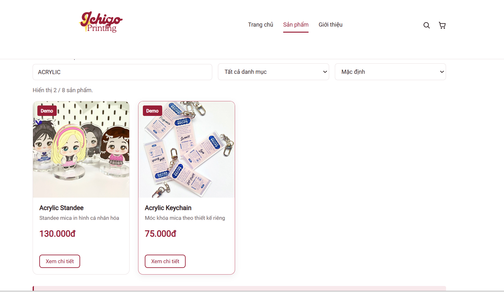
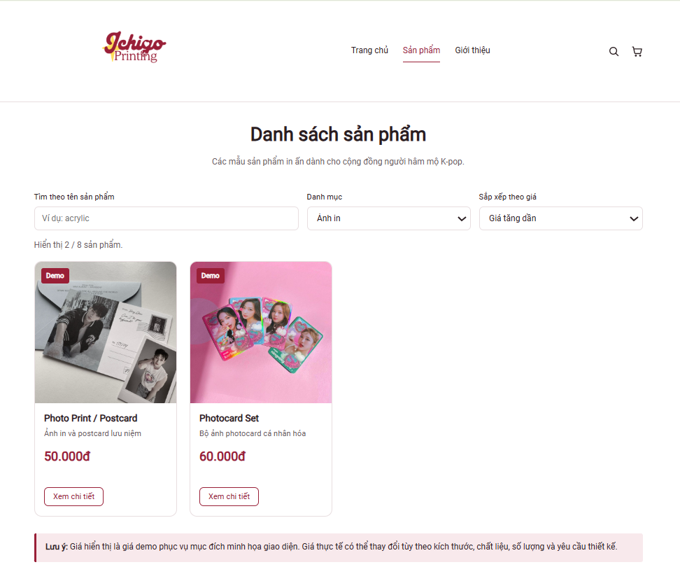
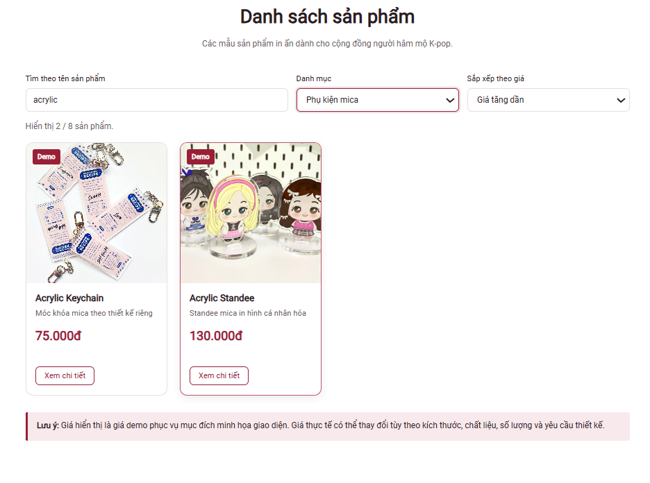
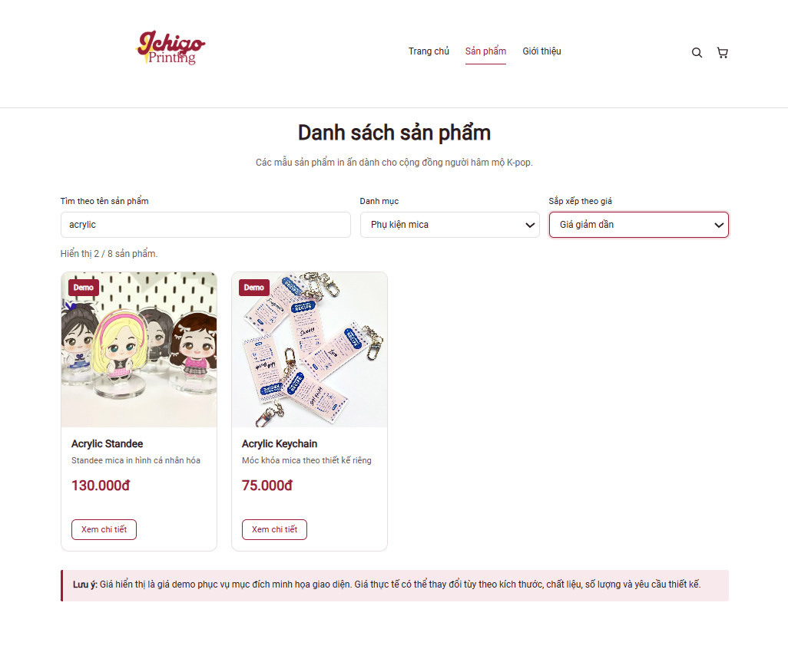
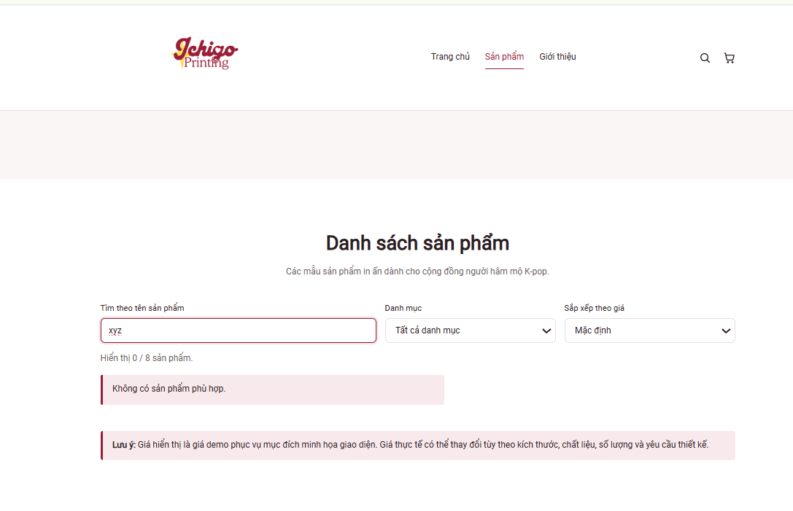
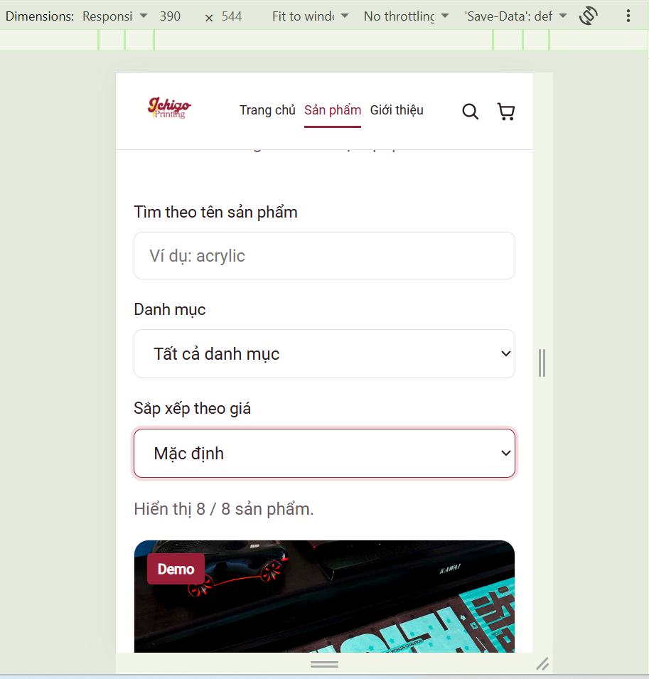
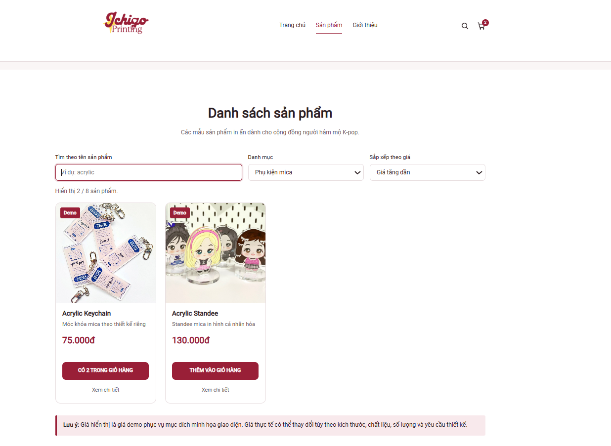

# Kiểm thử Buổi 3 – Prompt 3

**Dự án:** Ichigo Printing.

**Phạm vi:** Tìm kiếm theo tên, lọc danh mục, sắp xếp theo giá và ghép với phần giỏ hàng đã có trên nhánh chung.

**Ngày ghi nhận:** 08/11/2026.

**Cập nhật minh chứng:** 09/11/2026.

## 1. Phiên bản và cách kiểm tra

| Hạng mục | Nguồn và phạm vi xác nhận |
|---|---|
| Đầu vào trước Prompt 3 | Commit `384b263`; có 8 sản phẩm và `renderProducts(list)` |
| Ảnh thao tác tại máy | P3-UI-01 đến P3-UI-06 thuộc bản trước ghép; P3-UI-07 thuộc bản sau cập nhật d7e62c2 và áp dụng gói tích hợp |
| Bản ghép đang chuẩn bị | Giữ cập nhật giỏ hàng từ `main` tại `d7e62c2`; bổ sung tìm kiếm, lọc và sắp xếp |
| Kiểm thử xử lý dữ liệu | 16 ca bằng Node.js; giữ nguyên mảng nguồn và các bản ghi đã đóng băng |
| Kiểm thử tích hợp | 12 ca bằng Node.js và LinkeDOM; kiểm tra DOM, sự kiện, giỏ hàng và lưu trữ mô phỏng |
| Giới hạn | LinkeDOM không có bộ dựng bố cục trình duyệt. Ảnh P3-UI-07 bổ sung kiểm tra bản ghép tại máy; các thao tác chưa có xác nhận riêng vẫn được đánh dấu ở mục 5 |

## 2. Kết quả ghi nhận từ ảnh tại máy

### P3-UI-01. Tìm kiếm theo tên

| Điều kiện | Kết quả quan sát | Đánh giá |
|---|---|---|
| `ACRYLIC`, tất cả danh mục, mặc định | Acrylic Standee và Acrylic Keychain; hiển thị 2 / 8 sản phẩm. | Đạt trong khung ảnh được cung cấp |

### P3-UI-02. Danh mục và giá tăng dần

| Điều kiện | Kết quả quan sát | Đánh giá |
|---|---|---|
| Từ khóa rỗng, Ảnh in, giá tăng dần | Photo Print / Postcard 50.000đ đứng trước Photocard Set 60.000đ; hiển thị 2 / 8. | Đạt trong khung ảnh được cung cấp |

### P3-UI-03. Kết hợp ba điều kiện, giá tăng dần

| Điều kiện | Kết quả quan sát | Đánh giá |
|---|---|---|
| `acrylic`, Phụ kiện mica, giá tăng dần | Acrylic Keychain 75.000đ đứng trước Acrylic Standee 130.000đ; hiển thị 2 / 8. | Đạt trong khung ảnh được cung cấp |

### P3-UI-04. Kết hợp ba điều kiện, giá giảm dần

| Điều kiện | Kết quả quan sát | Đánh giá |
|---|---|---|
| `acrylic`, Phụ kiện mica, giá giảm dần | Acrylic Standee 130.000đ đứng trước Acrylic Keychain 75.000đ; hiển thị 2 / 8. | Đạt trong khung ảnh được cung cấp |

### P3-UI-05. Không có kết quả

| Điều kiện | Kết quả quan sát | Đánh giá |
|---|---|---|
| `xyz`, tất cả danh mục, mặc định | Hiển thị 0 / 8 và thông báo “Không có sản phẩm phù hợp.”; không còn thẻ sản phẩm. | Đạt trong khung ảnh được cung cấp |

### P3-UI-06. Bố cục màn hình hẹp và viền focus

| Điều kiện | Kết quả quan sát | Đánh giá |
|---|---|---|
| Thanh Dimensions ghi 390 × 544 px; từ khóa rỗng, tất cả danh mục, mặc định | Ba điều khiển xếp dọc trong khung ảnh; nhãn đọc được; viền focus ở ô sắp xếp rõ; hiển thị 8 / 8. | Đạt trong khung ảnh được cung cấp |

### P3-UI-07. Bộ lọc giữ nút giỏ hàng sau tích hợp

| Điều kiện | Kết quả quan sát | Đánh giá |
|---|---|---|
| Từ khóa rỗng; Phụ kiện mica; giá tăng dần | Keychain 75.000đ trước Standee 130.000đ; hiển thị 2 / 8; cả hai có nút giỏ hàng | Đạt qua ảnh bản ghép tại máy |
| Trạng thái giỏ hiện tại | Nút Keychain ghi số lượng 2, khớp badge 2 trên header | Nhất quán trong khung ảnh; chưa xác nhận mức tăng sau từng click |

Ảnh của ô sắp xếp xác nhận viền focus được hiển thị. Ảnh tĩnh không xác nhận riêng toàn bộ thứ tự Tab hoặc việc nhấn Enter có tải lại trang hay không. Không suy ra kích thước viewport của các ảnh desktop từ kích thước tệp PNG.

## 3. Kiểm thử các hàm dữ liệu bằng Node.js

| Mã | Trường hợp | Kết quả thực tế | Đánh giá |
|---|---|---|---|
| P3-DATA-01 | Mặc định | `[1, 2, 3, 4, 5, 6, 7, 8]` | Đạt trong Node.js |
| P3-DATA-02 | Tìm acrylic | `[7, 8]` | Đạt trong Node.js |
| P3-DATA-03 | Không phân biệt hoa thường | `[7, 8]` | Đạt trong Node.js |
| P3-DATA-04 | Bỏ khoảng trắng đầu cuối | `[2, 4]` | Đạt trong Node.js |
| P3-DATA-05 | Tìm photo | `[5, 6]` | Đạt trong Node.js |
| P3-DATA-06 | Danh mục Ảnh in | `[5, 6]` | Đạt trong Node.js |
| P3-DATA-07 | Tất cả danh mục | `[1, 2, 3, 4, 5, 6, 7, 8]` | Đạt trong Node.js |
| P3-DATA-08 | Giá tăng dần | `[4, 6, 5, 8, 3, 1, 7, 2]` | Đạt trong Node.js |
| P3-DATA-09 | Giá giảm dần | `[2, 7, 1, 3, 8, 5, 6, 4]` | Đạt trong Node.js |
| P3-DATA-10 | Danh mục kết hợp giá | `[6, 5]` | Đạt trong Node.js |
| P3-DATA-11 | Kết hợp ba điều kiện | `[7, 8]` | Đạt trong Node.js |
| P3-DATA-12 | Từ khóa kết hợp giá | `[4, 2]` | Đạt trong Node.js |
| P3-DATA-13 | Không có kết quả | `[]` | Đạt trong Node.js |
| P3-DATA-14 | Từ khóa và danh mục không khớp | `[]` | Đạt trong Node.js |
| P3-DATA-15 | Nguồn rỗng | `[]` | Đạt trong Node.js |
| P3-DATA-16 | Danh mục không trùng | `["Slogan", "Quạt", "Huy hiệu", "Ảnh in", "Phụ kiện mica"]` | Đạt trong Node.js |

Đối chiếu toàn bộ dữ liệu trước và sau các ca kiểm thử cho kết quả không thay đổi. Mảng nguồn và các bản ghi đã được đóng băng khi chạy các hàm dữ liệu.

## 4. Rà soát và kiểm thử phần ghép giỏ hàng

Mã `cart-list.js` trên `main` chỉ gắn nút sau `DOMContentLoaded`. Khi ghép trực tiếp với bộ lọc, `renderProducts` thay các thẻ sản phẩm nên các nút được gắn trước đó bị loại khỏi DOM. Trường hợp này đã tái hiện trong Node.js với LinkeDOM: ban đầu có đủ nút, sau tìm kiếm còn thẻ sản phẩm nhưng không còn nút giỏ hàng.

Bản ghép bổ sung `data-product-id` và sự kiện `products:rendered`. `cart-list.js` dùng ID để gắn lại nút sau mỗi lần render và chỉ gắn một lần cho mỗi nút. Các listener `pageshow` và `storage` được đăng ký ở phạm vi module, thay vì đăng ký lại cho từng thẻ sau mỗi lần lọc.

| Mã | Trường hợp | Kết quả thực tế | Môi trường |
|---|---|---|---|
| P3-INT-01 | Mở trang: đủ thẻ sản phẩm và nút giỏ hàng | Đạt | Node.js + LinkeDOM |
| P3-INT-02 | Tìm kiếm vẫn giữ nút giỏ hàng | Đạt | Node.js + LinkeDOM |
| P3-INT-03 | Từ khóa và danh mục không khớp tạo danh sách rỗng | Đạt | Node.js + LinkeDOM |
| P3-INT-04 | Lọc Ảnh in và sắp xếp tăng dần | Đạt | Node.js + LinkeDOM |
| P3-INT-05 | Thêm vào giỏ sau lọc cập nhật số lượng và badge | Đạt | Node.js + LinkeDOM |
| P3-INT-06 | Kết hợp ba điều kiện vẫn gắn đúng nút theo ID | Đạt | Node.js + LinkeDOM |
| P3-INT-07 | Đổi thứ tự giảm dần giữ số lượng đang có trong giỏ | Đạt | Node.js + LinkeDOM |
| P3-INT-08 | Không có kết quả rồi khôi phục danh sách giữ giỏ hàng | Đạt | Node.js + LinkeDOM |
| P3-INT-09 | Thông báo render lặp lại không tạo trùng nút hoặc sự kiện click | Đạt | Node.js + LinkeDOM |
| P3-INT-10 | Sự kiện storage cập nhật nút và badge | Đạt | Node.js + LinkeDOM |
| P3-INT-11 | Sự kiện submit được ngăn hành vi mặc định | Đạt | Node.js + LinkeDOM |
| P3-INT-12 | Liên kết chi tiết đúng ID; dữ liệu gốc giữ nguyên; không ghi nhận lỗi thực thi trong môi trường kiểm thử | Đạt | Node.js + LinkeDOM |

## 5. Các thao tác cần xác nhận trên bản ghép tại máy

| Mã | Thao tác | Kết quả mong đợi | Trạng thái |
|---|---|---|---|
| P3-REAL-01 | Tìm `acrylic`, lọc Phụ kiện mica, đổi giá tăng/giảm | Các thẻ vẫn có nút thêm vào giỏ, thứ tự giá đúng | Đã xác nhận Phụ kiện mica + giá tăng dần ở P3-UI-07; chưa có ảnh riêng cho từ khóa và chiều giảm dần trên bản ghép |
| P3-REAL-02 | Nhấn thêm một lần sau khi lọc | Đúng sản phẩm được thêm; số lượng tăng một; badge cập nhật | Ảnh P3-UI-07 ghi Keychain 2 và badge 2; mức tăng sau một lần click chưa được xác nhận riêng |
| P3-REAL-03 | Tìm `xyz`, sau đó xóa từ khóa | Thông báo rỗng rồi danh sách và nút giỏ được khôi phục | Chờ kiểm tra bản ghép trên trình duyệt |
| P3-REAL-04 | Mở viewport 390 × 544 px | Điều khiển, thẻ và nút giỏ nằm trong chiều rộng trang | Chờ kiểm tra bản ghép trên trình duyệt |
| P3-REAL-05 | Dùng Tab qua các điều khiển và nhấn Enter trong ô tìm kiếm | Có focus rõ, trang giữ trạng thái lọc và không tải lại | Chờ xác nhận thao tác trên trình duyệt |

Phạm vi báo cáo này thuộc Prompt 3; không xác nhận thay toàn bộ phần giỏ hàng, trang chi tiết hoặc các chức năng khác của Buổi 3.
