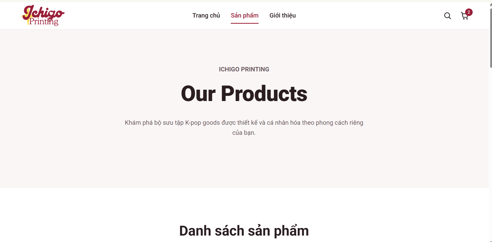
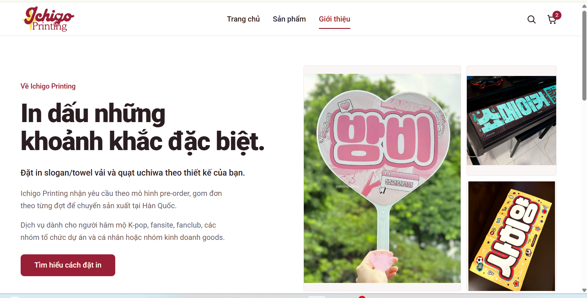
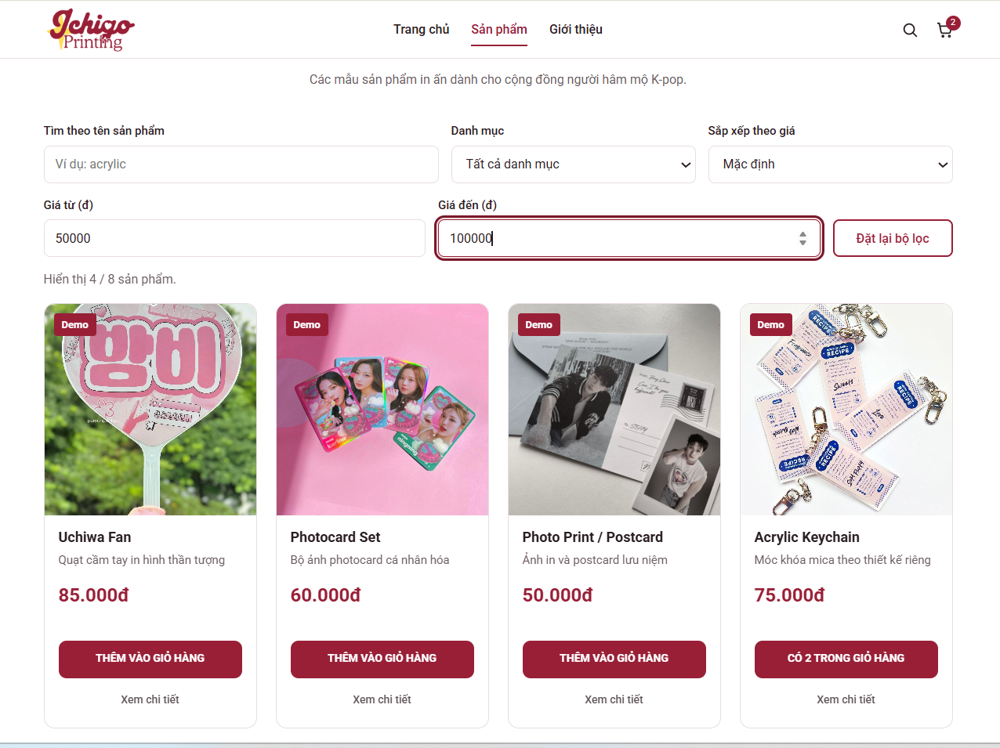
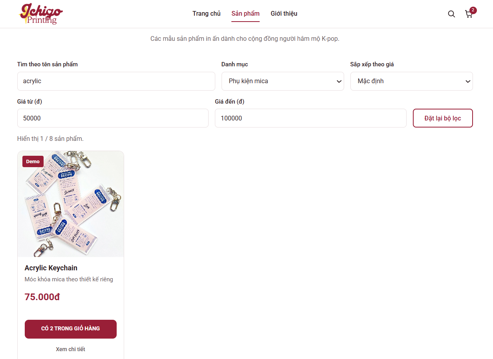
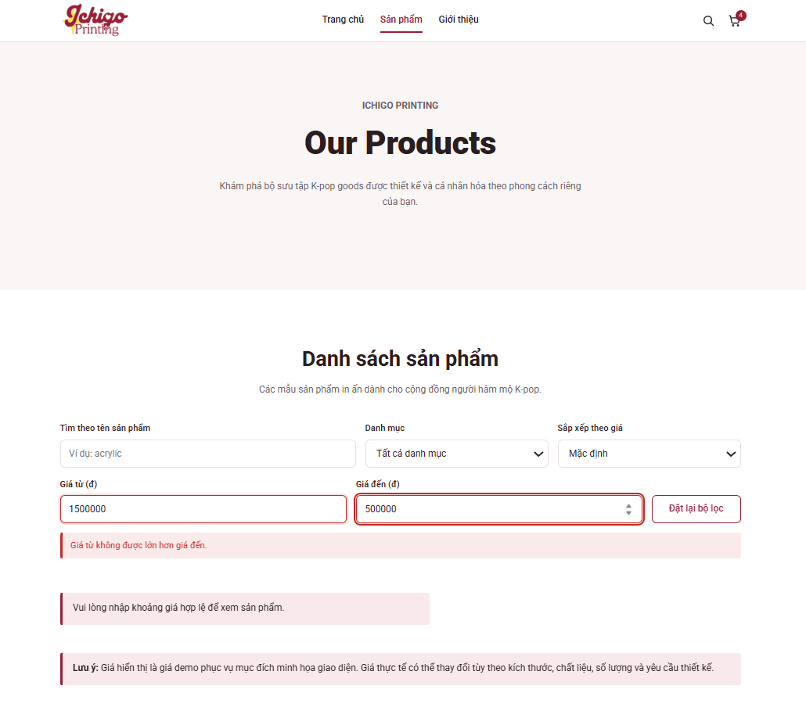
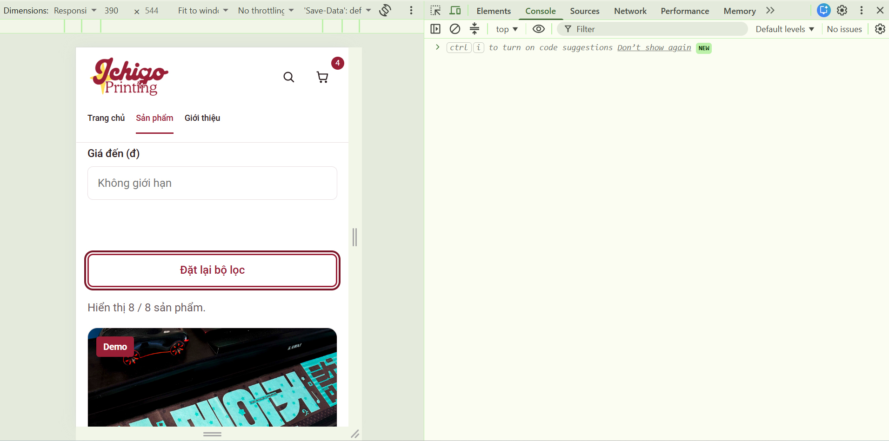
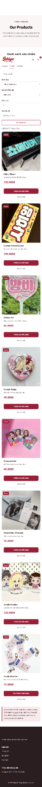

# Kiểm thử mở rộng Buổi 3 – Ichigo Printing

Ngày ghi nhận: 09/11/2026.

## 1. Phạm vi và phiên bản

| Nội dung | Phiên bản hoặc phạm vi |
|---|---|
| Đồng bộ header | Commit `e5b012b`; dùng trang About làm tham chiếu |
| Lọc khoảng giá và đặt lại | Commit `91cad95`; thay `product.html`, `search-filter.js` và thêm `product-filter.css` |
| Dữ liệu | 8 sản phẩm dùng chung; không thay giá hoặc bản ghi nguồn |
| Phản hồi AI | Claude tạo đề xuất; ChatGPT/Codex rà mã, kiểm tra và hỗ trợ điều chỉnh |
| Kiểm tra bằng mã | Node.js + LinkeDOM trên mã đọc lại từ GitHub ở commit `91cad95` |
| Giới hạn | DOM mô phỏng không dựng bố cục và không xác nhận toàn bộ thao tác trên trình duyệt thật |

## 2. Đối chiếu header qua ảnh desktop

Hai ảnh cho thấy cách bố trí logo, menu, biểu tượng và badge tương đồng; mục đang mở được đánh dấu tương ứng. Các trang còn lại đã được đối chiếu cấu trúc mã, chưa có ảnh riêng trong báo cáo này.

## 3. Lọc khoảng giá trên giao diện

| Điều kiện | Kết quả quan sát | Đánh giá |
|---|---|---|
| Giá từ 50.000đ đến 100.000đ; tất cả danh mục; Mặc định | 4/8 sản phẩm: Uchiwa Fan 85.000đ, Photocard Set 60.000đ, Photo Print / Postcard 50.000đ, Acrylic Keychain 75.000đ | Đúng khoảng giá và thứ tự gốc. Ảnh này không xác nhận sắp xếp giá tăng dần |

## 4. Kết hợp từ khóa, danh mục và khoảng giá

| Điều kiện | Kết quả quan sát | Đánh giá |
|---|---|---|
| acrylic; Phụ kiện mica; 50.000–100.000đ; Mặc định | Chỉ Acrylic Keychain 75.000đ; đếm 1/8 | Đạt trong ảnh được cung cấp |
| Trạng thái giỏ hàng | Nút Keychain ghi số lượng 2, badge header là 2 | Nhất quán trong khung ảnh; chưa chứng minh mức tăng sau từng click |

## 5. Khoảng giá không hợp lệ

| Điều kiện | Kết quả quan sát | Đánh giá |
|---|---|---|
| Giá từ 1.500.000đ; giá đến 500.000đ | Báo “Giá từ không được lớn hơn giá đến.”; đánh dấu hai ô; vùng danh sách yêu cầu nhập khoảng giá hợp lệ và không có thẻ | Đạt trong ảnh được cung cấp |

## 6. Mobile và điều chỉnh khoảng cách

| Thời điểm | Kết quả quan sát | Kết luận |
|---|---|---|
| Trước sửa; Dimensions ghi 390 × 544 | Điều khiển xếp dọc; nút đặt lại có focus; đếm 8/8; khoảng trống lớn giữa ô giá đến và nút | Cần sửa CSS |
| Sau sửa selector mobile | Ảnh toàn trang không còn khoảng trống lớn trước nút | Đã có ảnh đối chiếu tổng quát; chưa có ảnh cận mới ghi rõ Dimensions để xác nhận đầy đủ |

Nguyên nhân được đối chiếu trong mã: `#filter-form .filter-price .filter-field` giữ `flex: 1 1 140px` do có độ ưu tiên cao hơn selector mobile cũ. Quy tắc mobile được bổ sung selector tương ứng để áp dụng `flex: 0 0 auto`.

Ảnh MR-UI-07 bị thu nhỏ còn 111 × 2047 pixel. Không suy ra CSS viewport hoặc khả năng đọc chữ từ kích thước tệp này. Header nằm giữa nội dung trong ảnh chụp có thể liên quan vị trí cuộn khi chụp với header sticky; chưa có căn cứ coi đây là lỗi CSS header.

## 7. Kết quả kiểm tra bằng Node.js + LinkeDOM

Các ca dưới đây do ChatGPT/Codex thực hiện trong môi trường hỗ trợ, không phải kết quả chạy tại VS Code của người thực hiện bài. Mã được lấy lại từ commit `91cad95`. Trạng thái validity của ô số và lưu trữ được mô phỏng.

| Mã | Trường hợp và kết quả đối chiếu | Kết quả |
|---|---|---|
| MR-DOM-01 | Ban đầu đủ 8 thẻ, 8 nút giỏ; đếm 8/8; 6 option gồm tất cả và 5 danh mục | Đạt |
| MR-DOM-02 | Khoảng 50.000–100.000đ, tăng dần: ID 6,5,8,3; đếm 4/8 | Đạt |
| MR-DOM-03 | Cùng khoảng giá, giảm dần: ID 3,8,5,6 | Đạt |
| MR-DOM-04 | Chỉ từ 100.000đ: ID 1,2,7; chỉ đến 60.000đ: ID 4,5,6; hai biên 75.000đ: ID 8; biên 0 được xử lý đúng | Đạt |
| MR-DOM-05 | Từ khóa ACRYLIC có khoảng trắng, Phụ kiện mica, 50.000–100.000đ và tăng dần: ID 8, đếm 1/8 | Đạt |
| MR-DOM-06 | Thêm Keychain sau lọc: số lượng và badge tăng tương ứng | Đạt |
| MR-DOM-07 | Đặt lại: điều khiển về mặc định, đủ ID 1–8 theo thứ tự gốc và giữ số lượng giỏ | Đạt |
| MR-DOM-08 | Giá từ 200.000đ: đếm 0/8, thông báo không có sản phẩm và phát sự kiện render | Đạt |
| MR-DOM-09 | Giá từ lớn hơn giá đến: đánh dấu hai ô, thông báo đúng, không có thẻ và vẫn phát sự kiện | Đạt |
| MR-DOM-10 | Sửa khoảng giá hợp lệ: xóa lỗi, aria-invalid, aria-describedby và custom validity; lọc hoạt động lại | Đạt |
| MR-DOM-11 | Từ chối số âm, thập phân, ký hiệu mũ, số vượt giới hạn an toàn, chữ và Infinity; chấp nhận ô trống và số nguyên không âm | Đạt |
| MR-DOM-12 | Giá âm chỉ ở một ô: chỉ đánh dấu ô đó và không hiển thị thẻ | Đạt |
| MR-DOM-13 | value rỗng nhưng badInput=true: vẫn báo lỗi; đặt lại khôi phục danh sách | Đạt với validity mô phỏng |
| MR-DOM-14 | Submit với giá hợp lệ hoặc không hợp lệ đều được preventDefault | Đạt trong DOM mô phỏng |
| MR-DOM-15 | Lọc, render và đặt lại lặp nhiều lần: mỗi thẻ có một nút; mỗi click tăng một; không trùng danh mục | Đạt |
| MR-DOM-16 | Gọi lại init: không gắn lặp listener submit hoặc option | Đạt |
| MR-DOM-17 | Sự kiện storage cập nhật nội dung nút và badge | Đạt |
| MR-DOM-18 | Giữ header, footer, thứ tự script/CSS, nhãn, link chi tiết, dữ liệu nguồn; không ghi nhận lỗi thực thi trong môi trường kiểm tra | Đạt |
| MR-DOM-19 | Script vẫn khởi tạo khi DOMContentLoaded đang chờ; lọc và thêm giỏ sau đó hoạt động | Đạt |

Tổng cộng 19/19 ca đạt trong môi trường mô phỏng. Kết quả này không thay thế kiểm tra bố cục, nhập số hoặc chuỗi thao tác bàn phím trên trình duyệt thật.

## 8. Các xác nhận trình duyệt còn thiếu

| Nội dung | Trạng thái |
|---|---|
| Khoảng giá kết hợp giá tăng/giảm trên bản mở rộng | Đã kiểm tra bằng mã; chưa có ảnh riêng của thao tác này |
| Gõ ký tự tạo badInput, sửa lỗi rồi đặt lại trên trình duyệt | Đã kiểm tra bằng mô phỏng; chưa có xác nhận thao tác thật riêng |
| Toàn bộ thứ tự Tab và Enter không tải lại trang | Ảnh có viền focus; chưa xác nhận đầy đủ chuỗi thao tác |
| Mobile sau sửa với Dimensions 390 × 544 rõ trong ảnh | Có ảnh tổng quát sau sửa; cần ảnh cận rõ để bổ sung |

## 9. Trạng thái lưu mã

| Commit | Nội dung | Trạng thái |
|---|---|---|
| `e5b012b` | Đồng bộ header | Đã push lên main và đọc lại trên GitHub |
| `91cad95` | Lọc khoảng giá và đặt lại | Đã push lên main; Terminal báo working tree sạch; đã đọc lại mã và kiểm tra lại 19 ca |

Phạm vi kiểm tra tập trung trang danh sách và điểm nối giỏ hàng. Không xác nhận thay toàn bộ nghiệp vụ giỏ hàng, đặt hàng hoặc các trang khác.
