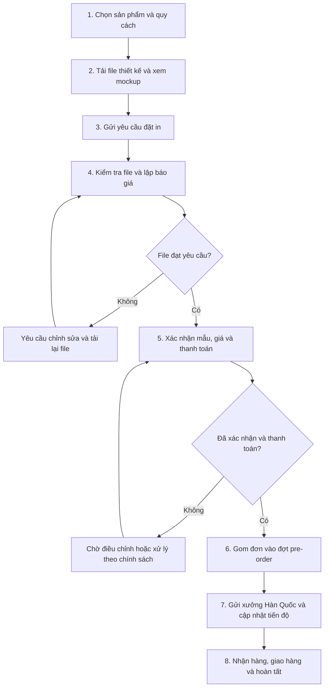

# Quy trình nghiệp vụ – Ichigo Printing

## 5. Xác định quy trình nghiệp vụ

### 5.1. Quy trình đặt in K-pop goods từ đặt hàng đến hoàn tất

Quy trình nghiệp vụ chính của website Ichigo Printing mô tả các bước từ khi khách hàng lựa chọn sản phẩm, gửi file thiết kế, xác nhận báo giá đến khi đơn hàng được gom theo đợt pre-order, sản xuất và giao đến khách hàng.

Quy trình gồm 8 bước như sau:

#### Bước 1: Chọn sản phẩm và quy cách

Khách hàng truy cập website Ichigo Printing, lựa chọn sản phẩm cần đặt in như slogan/towel vải hoặc uchiwa, sau đó xác định các thông số phù hợp như kích thước, chất liệu, mặt in và số lượng.

**Người thực hiện:** Khách hàng.

#### Bước 2: Tải file thiết kế và xem trước mockup

Khách hàng tải file thiết kế lên website và xem trước sản phẩm thông qua mockup 2D. Bước này giúp khách hàng kiểm tra sơ bộ bố cục và vị trí hình in trước khi gửi yêu cầu đặt in.

**Người thực hiện:** Khách hàng.

#### Bước 3: Gửi yêu cầu đặt in

Sau khi hoàn tất việc lựa chọn quy cách và tải file thiết kế, khách hàng gửi yêu cầu đặt in. Hệ thống tiếp nhận và lưu thông tin đơn hàng để nhân viên kiểm tra, xử lý.

**Người thực hiện:** Khách hàng và hệ thống.

#### Bước 4: Kiểm tra file thiết kế và lập báo giá

Nhân viên quản trị tiếp nhận yêu cầu, kiểm tra file thiết kế và thông tin quy cách sản phẩm. Nếu file chưa đáp ứng yêu cầu, nhân viên thông báo lý do để khách hàng chỉnh sửa và tải lại. Khi thông tin phù hợp, nhân viên lập báo giá để khách hàng xem xét và xác nhận.

**Người thực hiện:** Quản trị viên (Admin).

#### Bước 5: Xác nhận mẫu, giá và thanh toán

Khách hàng xem lại mẫu thiết kế cuối cùng và báo giá do nhân viên xác nhận. Nếu đồng ý, khách hàng xác nhận đơn hàng và thực hiện thanh toán. Nếu chưa đồng ý, khách hàng có thể yêu cầu điều chỉnh hoặc xử lý đơn theo chính sách của website.

Đơn chưa được xác nhận thanh toán sẽ chưa đủ điều kiện đưa vào danh sách gửi xưởng.

**Người thực hiện:** Khách hàng và quản trị viên.

#### Bước 6: Gom đơn vào đợt pre-order

Quản trị viên tổng hợp các đơn hàng đã đáp ứng điều kiện về file thiết kế, báo giá và thanh toán, sau đó phân loại và đưa vào đợt pre-order tương ứng.

Khi đợt pre-order kết thúc, quản trị viên đóng đợt, khóa thông tin đơn hàng theo quy định và chuẩn bị danh sách các đơn đủ điều kiện để gửi đến xưởng sản xuất.

**Người thực hiện:** Quản trị viên.

#### Bước 7: Gửi thông tin đến xưởng Hàn Quốc và cập nhật tiến độ

Quản trị viên tổng hợp thông tin sản phẩm, quy cách, số lượng và file thiết kế đã được xác nhận để chuyển đến xưởng in tại Hàn Quốc.

Trong quá trình sản xuất và vận chuyển, quản trị viên cập nhật trạng thái đơn hàng trên website để khách hàng theo dõi tiến độ.

**Người thực hiện:** Quản trị viên; xưởng in Hàn Quốc thực hiện công đoạn sản xuất.

#### Bước 8: Nhận hàng, giao hàng và hoàn tất

Sau khi sản phẩm được sản xuất và vận chuyển về Việt Nam, đơn hàng được xử lý giao đến khách hàng.

Khi khách hàng nhận được sản phẩm, đơn hàng được cập nhật sang trạng thái hoàn tất trên hệ thống.

**Người thực hiện:** Quản trị viên và khách hàng.

### Kết quả của quy trình

Đơn hàng được xử lý theo trình tự từ tiếp nhận yêu cầu đặt in đến khi giao hàng hoàn tất.

Khách hàng có thể xem trước thiết kế, xác nhận báo giá và theo dõi trạng thái đơn hàng trên website.

Đồng thời, quản trị viên có thể kiểm soát chất lượng file thiết kế, điều kiện thanh toán và việc tổng hợp đơn hàng theo từng đợt pre-order trước khi gửi thông tin đến xưởng sản xuất.

### Sơ đồ quy trình nghiệp vụ

*Hình 5.1. Quy trình đặt in sản phẩm trên website Ichigo Printing.*

*Nguồn: Nhóm tác giả.*

---

### 5.2. Các trường hợp ngoại lệ trong quy trình

Trong quá trình xử lý đơn hàng, website cần xem xét một số trường hợp ngoại lệ sau:

| Trường hợp | Cách xử lý |
|---|---|
| **File thiết kế không đạt yêu cầu** | Nhân viên từ chối file, ghi rõ lý do và yêu cầu khách hàng tải lại file trước khi xác nhận sản xuất. |
| **Khách hàng không đồng ý báo giá** | Đơn hàng giữ trạng thái chờ để điều chỉnh hoặc hủy theo chính sách áp dụng. |
| **Chưa xác nhận thanh toán** | Đơn hàng chưa được đưa vào danh sách gửi xưởng. |
| **Đợt pre-order đã đóng** | Không cho thêm đơn hoặc thay đổi trực tiếp thông tin thuộc đợt đã khóa. |
| **Tiến độ sản xuất bị chậm** | Nhân viên cập nhật trạng thái và ghi chú tiến độ để khách hàng nắm thông tin. |
| **Khách hàng yêu cầu hủy sau khi gửi xưởng** | Xử lý theo chính sách hủy đơn và hoàn tiền đã công bố. |

*Bảng 5.1. Các trường hợp ngoại lệ và phương án xử lý trong quy trình đặt in Ichigo Printing.*

*Nguồn: Nhóm tác giả.*

---

**Dự án:** Ichigo Printing  
**Môn học:** Phát triển ứng dụng TMĐT  
**Giảng viên:** TS. Nguyễn Mạnh Tuấn – tuannm@ueh.edu.vn
